<div align="center">

# Shongoti

### Evidence-First Financial Operating System & Multi-Agent AI Workbench for MSMEs

[](#technology-stack)
[](#technology-stack)
[](#technology-stack)
[](#technology-stack)
[](#system-architecture)
[](#hybrid-rag--multimodal-ingestion-pipeline)
[](#core-engineering-invariants)

**[Overview](#overview)** · **[Key Capabilities](#key-capabilities)** · **[Product Tour](#product-tour)** · **[System Architecture](#system-architecture)** · **[Database ER Diagram](#database-entity-relationship-er-diagram)** · **[Module Reference](#application-modules--route-reference)** · **[Quick Start](#getting-started)** · **[Verification](#testing--verification)**

</div>

---

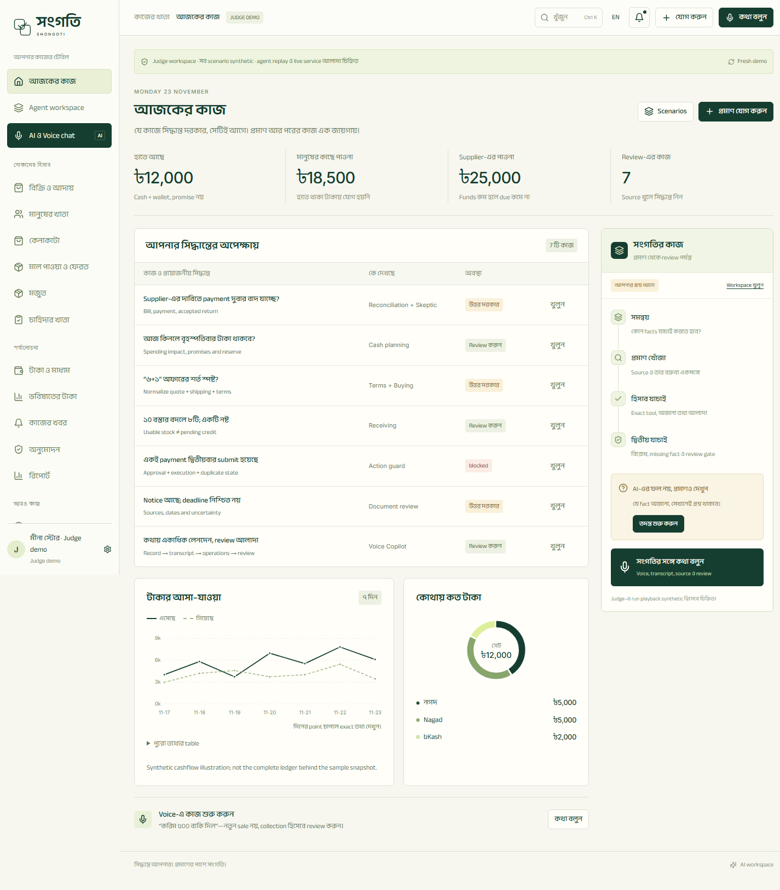

---

## Overview

**Shongoti** is a full-stack financial operating system and multi-agent AI workbench engineered for small and medium retail/wholesale enterprises (MSMEs). It bridges the gap between unstructured real-world business evidence—paper invoices, supplier delivery slips, handwritten receipts, PDF statements, and spoken voice notes—and a strict, auditable double-entry accounting ledger.

Most financial tools force merchants to choose between rigid accounting software that cannot interpret messy real-world documents and conversational AI wrappers that hallucinate numbers or silently corrupt financial records. Shongoti enforces a strict **Evidence-to-Ledger Boundary**:

1. **AI Extracts, Retrieves, and Critiques:** Multimodal models (Groq Vision, Whisper, and structured LLMs) combined with local Hybrid RAG (Multilingual E5 ONNX embeddings + Unicode BM25) read source files, transcribe compound voice notes, retrieve contract clauses, and investigate supplier billing discrepancies.
2. **Deterministic Code Computes Money:** All monetary arithmetic, supplier reconciliation hypotheses, landed unit-cost comparisons, usable stock additions, and 7-day liquidity simulations execute in deterministic integer-paisa domain engines (`1 BDT = 100 paisa`).
3. **Human Governance Controls Execution:** AI never directly posts money or triggers external transfers. Every proposed journal entry or payment draft requires explicit owner verification of the source quote, counterparty, account channel, and amount, protected by cryptographic idempotency keys.

---

## Key Capabilities

### 1. Sequential 4-Role Multi-Agent Investigation Engine
When a supplier statement conflicts with a merchant's payment receipts or goods return records, Shongoti runs an asynchronous (`HTTP 202`) multi-agent investigation with live progress polling, call-budget enforcement, and persisted provider/tool receipts:
* **Terms Evidence Specialist:** Extracts grounded claims, dates, invoice references, and verbatim quotes from attached documents.
* **Deterministic Reconciliation Tool (`ReconciliationEngine`):** Separates *event occurrence*, *invoice applicability*, and *prior deduction in the supplier's demand*. When prior deduction is unknown, it computes exact alternative payable amounts (e.g., `BDT 18,000` vs. `BDT 22,000`) rather than guessing.
* **Independent Skeptic Specialist:** Audits the evidence pack against the deterministic tool output to surface contradictions and missing critical facts.
* **Report Specialist:** Synthesizes the investigation trail, enforces the evidence-support confidence ceiling, and presents targeted clarification questions to the owner.

### 2. Multimodal Evidence Intake & Hybrid RAG Memory
* **Multimodal Ingestion:** Accepts native PDFs, scanned PDFs, invoice images (`.png`, `.jpg`, `.webp`), text files, and audio recordings up to 10 MB with SHA-256 content deduplication.
* **Safe Extraction Retry:** Failed or updated extractions can be reprocessed under the same `evidence_id` without overwriting claims already reviewed or corrected by a human operator.
* **Hybrid Retrieval (`RRF k=60`):** Combines local pinned **Multilingual E5 (`intfloat/multilingual-e5-small`) ONNX embeddings** with Unicode-aware **BM25 lexical search**, fused via Reciprocal Rank Fusion (`k=60`) with an exact invoice-identifier priority boost and strict tenant/revoked-document filtering.

### 3. Voice Copilot & Compound Transaction Splitting
* **Live Voice Studio:** Built-in browser audio recorder with real-time 16-bar frequency visualization and pre-submission playback, backed by **Groq Whisper** speech-to-text.
* **Compound Utterance Decomposition:** A single spoken note containing multiple financial events (e.g., *"Karim paid 500 BDT toward his old balance and took 300 BDT of rice on credit"*) is automatically decomposed into distinct typed operations (`debt_collection` vs. `credit_sale`) so old receivable collection never inflates sales revenue.
* **Proposal Review Gate:** Each proposed operation opens a dedicated verification screen requiring registered party selection, channel validation (`cash`, `bkash`, `nagad`), balance/due precondition checks, and a unique `source_hash` lock that prevents duplicate posting.

### 4. End-to-End Commerce, Procurement & Floor Operations
* **Guarded Daily Commerce:** Cash, credit, and split sales with atomic SKU inventory deduction; receivable collections; multi-channel treasury operations (Cash, bKash, Nagad transfers with explicit fee accounting, operating expenses, owner equity draws, supplier payments, and daily drawer close).
* **Procurement & Credit Recovery:** Landed unit-cost quote comparisons (*Buying Desk*), physical delivery intake that adds **only usable units (`received - damaged`)** to inventory, and a source-backed **Supplier Credit Acceptance Gate** requiring original proof before marking shortage/damage credits as accepted.
* **7-Day Liquidity Decision Lab:** Non-mutating cashflow simulator that stress-tests proposed purchases, recurring commitments (rent, payroll, utilities), safety reserve targets, and conditional customer payment promises to pinpoint exact reserve-breach and cash-shortfall dates.
* **Everyday Shop Operations & Compliance Help Desk:** Non-revenue unmet demand memory, customer reservation picking lists, returnable container/crate deposit tracking, cashier shift handovers with non-accusatory variance hypotheses, scoped public customer invoice portals (`/pay/:token`), and a statute-cited MSME compliance document vault.

---

## Core Engineering Invariants

| ID | Invariant | Architectural Enforcement |
| :--- | :--- | :--- |
| **INV-01** | **Integer-Paisa Arithmetic** | All balances, postings, dues, offers, and scenarios are stored and calculated as 64-bit/32-bit integers in paisa (`1 BDT = 100 paisa`). Floating-point money math is prohibited. |
| **INV-02** | **Balanced Double-Entry Ledger** | Every financial mutation generates a `JournalEntryModel` whose child `PostingModel` rows strictly satisfy $\sum \text{Debits} = \sum \text{Credits}$ within an atomic database transaction. |
| **INV-03** | **Spendable Funds vs. Promises** | Available liquidity includes only verified `asset:cash` and `asset:wallet:*` balances. Customer receivables, payment promises, and scenario projections never increase spendable cash. |
| **INV-04** | **Zero Revenue Inflation on Collections** | Collecting an existing customer receivable credits Accounts Receivable and debits Cash/Wallet without touching Sales Revenue. |
| **INV-05** | **Three-Fact Reconciliation Separation** | Payment/return *occurrence*, *invoice applicability*, and *prior inclusion in supplier demand* are modeled as independent state variables. |
| **INV-06** | **Usable-Only Inventory & Source-Backed Credits** | Delivery receipts increment SKU stock strictly by `received_quantity - damaged_quantity`. Shortage/damage credit notes start as `suspected` and require an uploaded original source + owner confirmation to transition to `accepted`. |
| **INV-07** | **Deterministic Evidence-Support Policy (`evidence-support-v1`)** | Public confidence is a deterministic evidence-support index, never an LLM self-rating. Any missing critical fact caps the score at **`<= 59 / 100`** and forces `readiness = needs_clarification`. |

---

## Product Tour

### 1. Public Landing, Authentication & Isolated Judge Provisioning
Shongoti provides both standard merchant registration/sign-in (HMAC-SHA256 JWT + salted password hashing) and a one-click **Judge Workspace** entry. Selecting the Judge entry dynamically provisions an isolated tenant in the primary database seeded with realistic starting records—executing every action through the exact same FastAPI endpoints and live Groq inference pipeline as production accounts.

| Public Landing Page (`/`) | Authentication & One-Click Judge Provisioning (`/login`) |
| :---: | :---: |
| 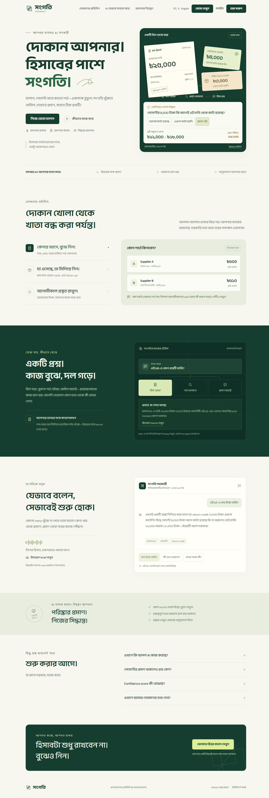 | 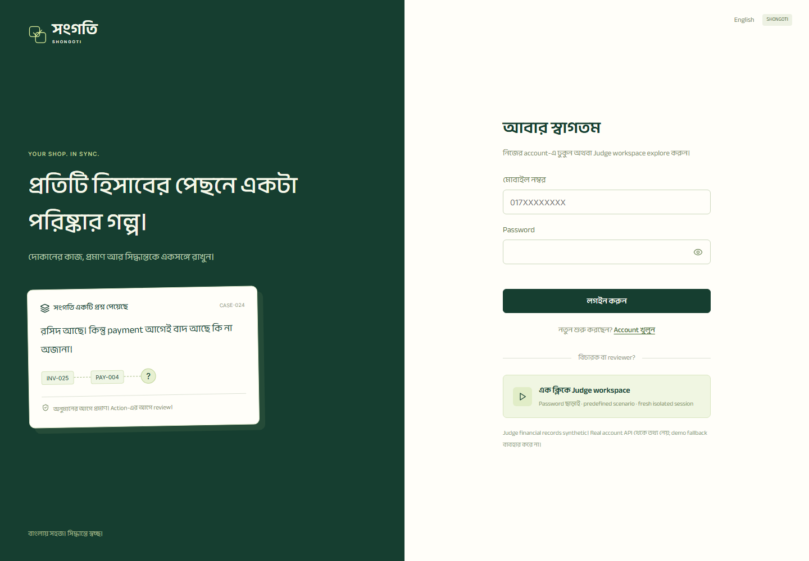 |

---

### 2. Three-Source Case Reconciliation & Multi-Agent Investigation Workspace
The Case Workspace (`/app/cases/:caseId`) places the **Supplier Demand**, **Payment Receipt**, and **Accepted Return** side-by-side with direct links to the underlying evidence files. Launching an investigation (`/app/agents/:runId`) runs the 4-role specialist pipeline, streaming task states, token/latency receipts, and deterministic payable alternatives.

| 3-Source Case Reconciliation Stage (`/app/cases/:caseId`) | 4-Role Multi-Agent Investigation Trail (`/app/agents/:runId`) |
| :---: | :---: |
| 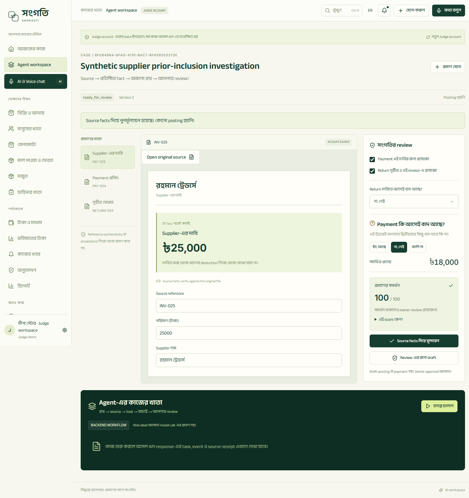 | 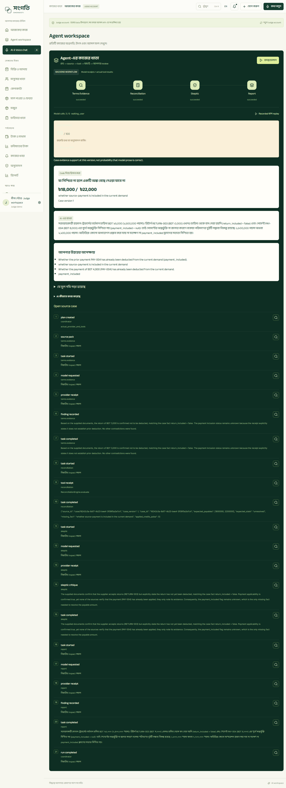 |

---

### 3. Voice Copilot, Multimodal Evidence Vault & Hybrid RAG Search
The Shop Copilot (`/app/copilot`) combines live microphone capture, Groq Whisper transcription, compound transaction splitting, and source-grounded Q&A. The Evidence Library (`/app/evidence`) manages multimodal file extraction, human claim correction, retry-safe reprocessing, and Hybrid RAG search across Bangla and English documents.

| Voice Studio & Grounded Copilot (`/app/copilot`) | Whisper Transcription & Split Operation Proposals (`/app/copilot`) | Multimodal Evidence Vault & Safe Retry (`/app/evidence/:id`) |
| :---: | :---: | :---: |
|  |  | 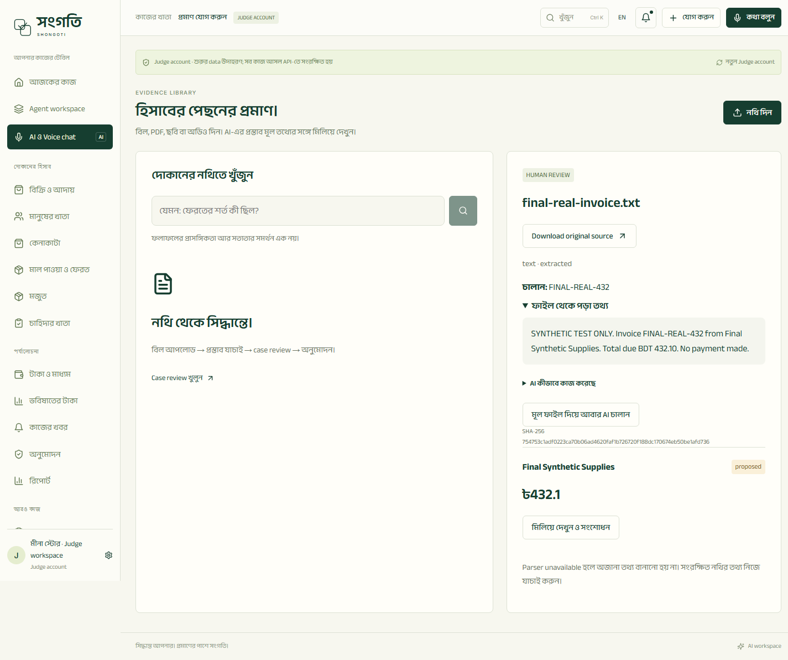 |

---

### 4. Daily Commerce, Counterparty Ledger & Scoped Customer Invoice Portal
The Sales register (`/app/sales`) enforces strict separation between new sales (cash, credit, split) and old debt collections. The People directory (`/app/people`) tracks customer receivables and supplier payables and generates token-scoped public invoice links (`/pay/:token`) where customers can review itemized bills and submit persistent dispute notes.

| Guarded Sales & Due Collections (`/app/sales`) | Customer & Supplier Directory (`/app/people`) | Scoped Public Customer Invoice Portal (`/pay/:token`) |
| :---: | :---: | :---: |
| 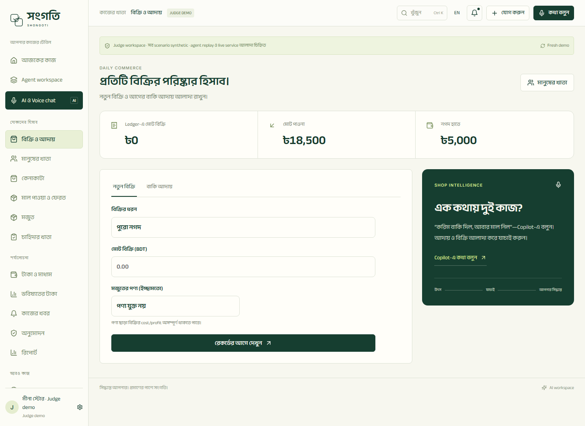 |  |  |

---

### 5. Buying Desk, Delivery Receiving, Credit Recovery, Inventory & Demand Memory
Procurement workflows span quote normalization on the Buying Desk (`/app/buying`), usable-only physical receiving (`/app/receiving`), source-backed supplier credit acceptance, Weighted Average Cost (WAC) inventory management with CSV import (`/app/stock`), and non-revenue unmet demand logging (`/app/demand`).

| Buying Desk Landed-Cost Comparison (`/app/buying`) | Delivery Intake & Credit Tracker (`/app/receiving`) | Source-Backed Supplier Credit Acceptance Gate |
| :---: | :---: | :---: |
| 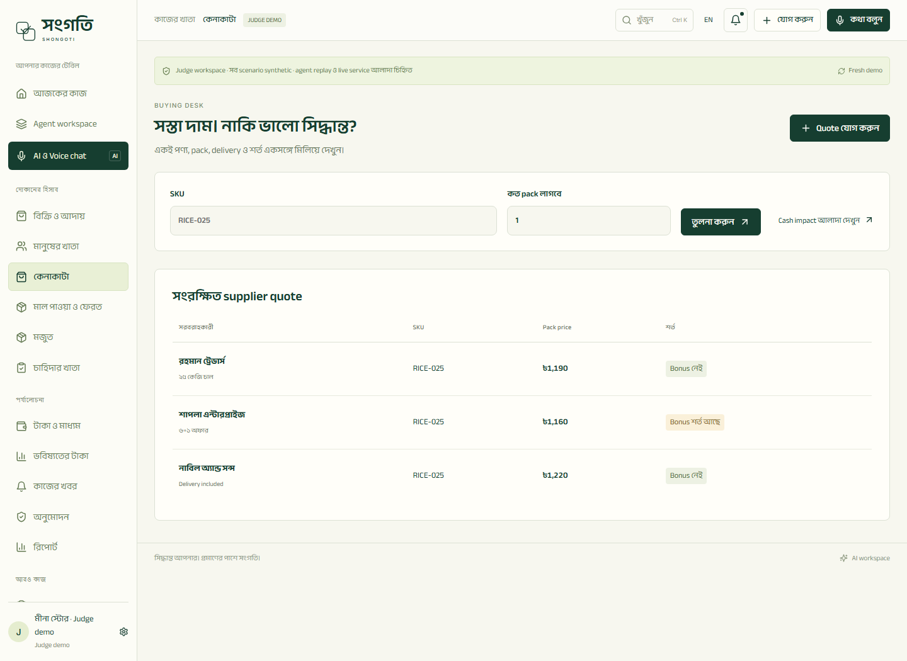 |  |  |

| Shelf Inventory, WAC & CSV Import (`/app/stock`) | Unmet Demand Memory & Reorder Analysis (`/app/demand`) |
| :---: | :---: |
| 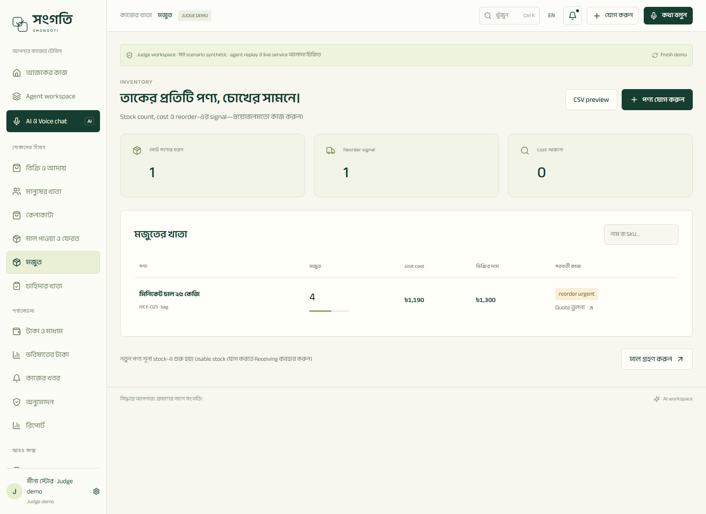 | 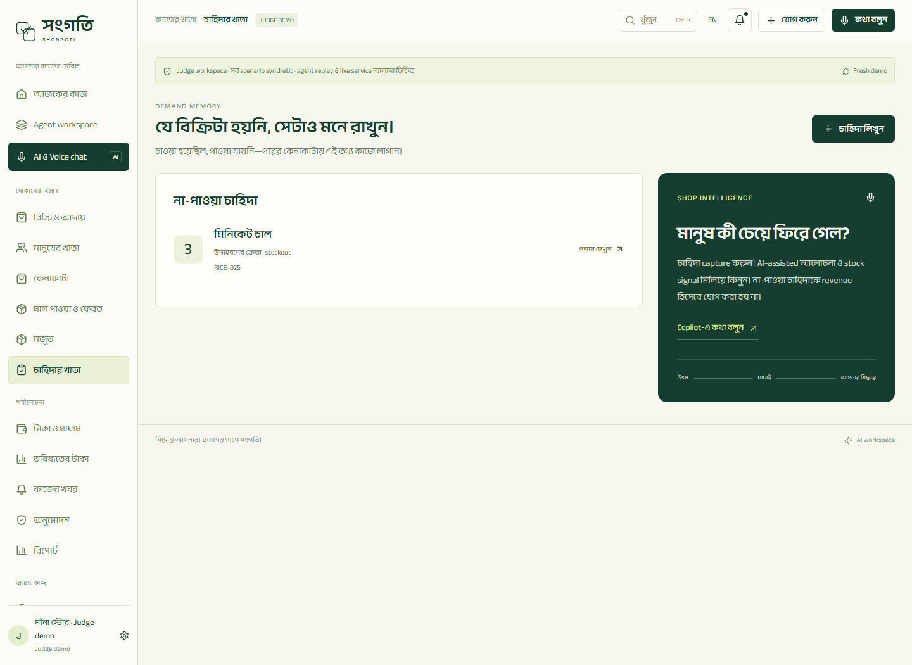 |

---

### 6. Multi-Channel Treasury, 7-Day Cash Planner, Inbox, Approvals & Operating Reports
Financial planning and governance modules include multi-channel treasury management across Cash, bKash, and Nagad (`/app/money`), the 7-day non-mutating liquidity simulator (`/app/planner`), the priority-sorted Actionable Inbox with daily audio briefings (`/app/inbox`), the RBAC-guarded Owner Approval queue (`/app/actions`), and four separated operating statements (`/app/reports`).

| Multi-Channel Treasury (`/app/money`) | 7-Day Cash Planning & Decision Lab (`/app/planner`) |
| :---: | :---: |
|  |  |

| Actionable Inbox & Audio Brief (`/app/inbox`) | Owner Approvals & Duplicate Guard (`/app/actions`) | 4 Separated Operating Statements (`/app/reports`) |
| :---: | :---: | :---: |
| 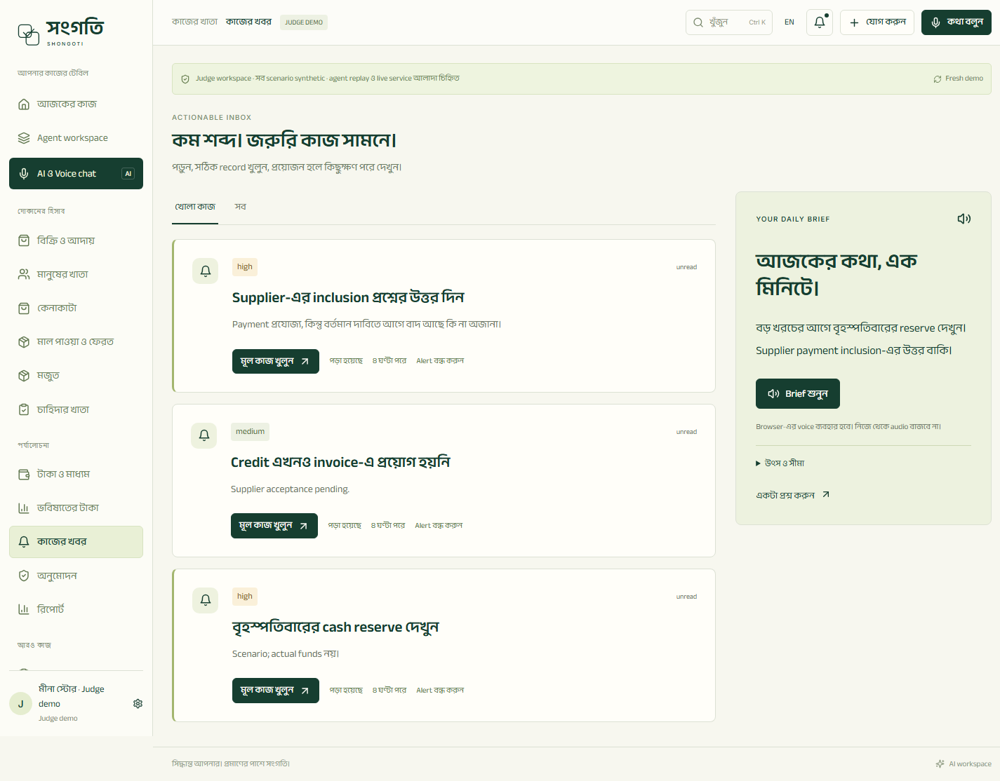 |  |  |

---

### 7. Shop-Floor Operations, Compliance Help Desk, Live Capabilities & Scenario Library
Additional operational modules cover customer reservations, returnable crate/container deposits, cashier shift handovers, and supplier price-change impact (`/app/operations`), a statutory compliance vault (`/app/help`), live runtime capability inspection (`/app/connections`), accessibility preferences (`/app/settings`), and an interactive 7-case scenario library (`/app/scenarios`).

| Shop-Floor Operations Hub (`/app/operations`) | MSME Compliance & Statute Help Desk (`/app/help`) |
| :---: | :---: |
|  |  |

| Live Capability Inspector (`/app/connections`) | Workspace Preferences (`/app/settings`) | Interactive Scenario Library (`/app/scenarios`) |
| :---: | :---: | :---: |
| 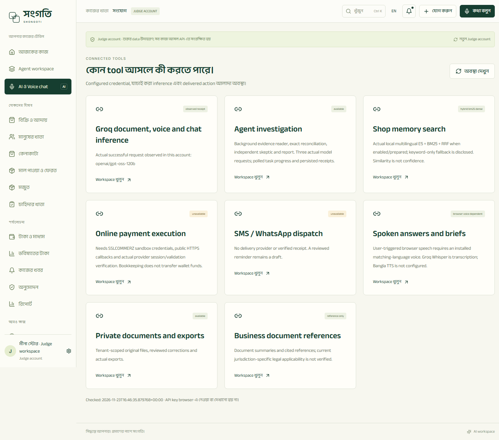 |  | 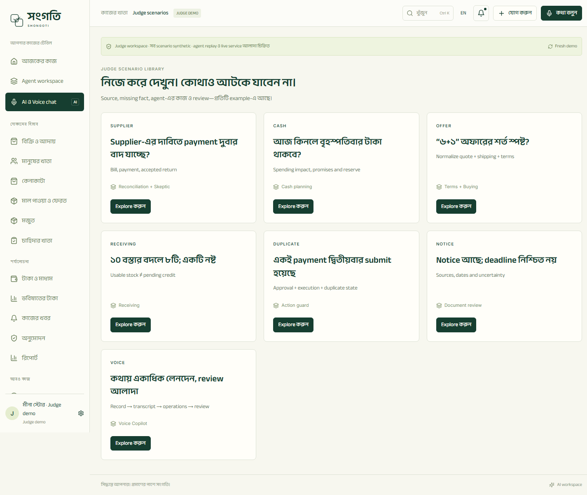 |

---

## System Architecture

### 1. Modular Monolith & AI Boundary Topology

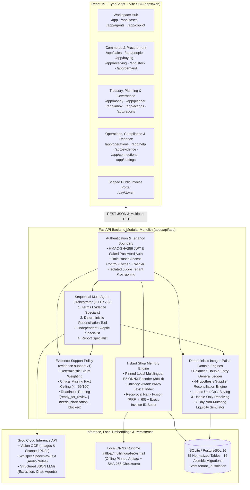

### 2. Multi-Agent Investigation & Human Review Sequence

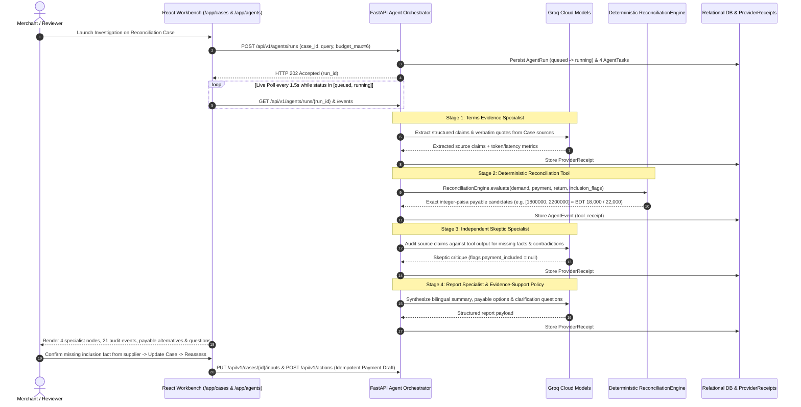

### 3. Hybrid RAG & Multimodal Ingestion Pipeline

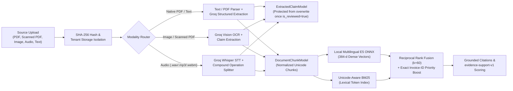

---

## Database Entity-Relationship (ER) Diagram

The persistence schema defined in [`apps/api/app/persistence/models.py`](apps/api/app/persistence/models.py) and managed across **16 sequential Alembic migrations** ([`apps/api/alembic/versions/`](apps/api/alembic/versions/)) consists of **35 normalized relational tables**. All tenant records enforce `tenant_id` foreign-key cascades and integer-paisa monetary storage.

```mermaid
erDiagram
    TENANTS ||--o{ USERS : "isolates"
    USERS ||--o| USER_CREDENTIALS : "authenticates"
    TENANTS ||--o{ ACCOUNTS : "owns_chart_of_accounts"
    TENANTS ||--o{ JOURNAL_ENTRIES : "records_double_entry"
    JOURNAL_ENTRIES ||--|{ POSTINGS : "contains_balanced_lines"
    ACCOUNTS ||--o{ POSTINGS : "debits_or_credits"
    TENANTS ||--o{ DAILY_SNAPSHOTS : "tracks_drawer_close"
    TENANTS ||--o{ OBLIGATIONS : "tracks_payables"
    OBLIGATIONS ||--o{ ALLOCATIONS : "allocates_payments"
    TENANTS ||--o{ AUDIT_LOGS : "records_audit_trail"

    TENANTS ||--o{ PARTIES : "manages_counterparties"
    TENANTS ||--o{ PRODUCTS : "catalogs_skus"
    PRODUCTS ||--o{ STOCK_MOVEMENTS : "logs_inventory_deltas"
    PARTIES ||--o{ CUSTOMER_PORTAL_TOKENS : "scopes_public_invoice"
    PARTIES ||--o{ PURCHASE_DRAFTS : "supplies"
    PRODUCTS ||--o{ PURCHASE_DRAFTS : "reorders"
    PARTIES ||--o{ RECURRING_COMMITMENTS : "schedules_outflows"

    TENANTS ||--o{ EVIDENCE : "stores_private_files"
    EVIDENCE ||--o{ EXTRACTED_CLAIMS : "yields_extracted_claims"
    TENANTS ||--o{ DOCUMENT_CHUNKS : "indexes_hybrid_rag"
    TENANTS ||--o{ PROVIDER_RECEIPTS : "audits_model_calls"

    TENANTS ||--o{ CASES : "investigates"
    CASES ||--o{ CASE_VERSIONS : "snapshots_state"
    CASES ||--o{ EVIDENCE_CLAIMS : "evaluates_facts"
    CASES ||--o{ CONFIDENCE_ASSESSMENTS : "scores_evidence_support_v1"
    CASES ||--o{ AGENT_RUNS : "spawns_investigation"
    AGENT_RUNS ||--|{ AGENT_TASKS : "executes_4_specialists"
    AGENT_RUNS ||--|{ AGENT_EVENTS : "streams_audit_events"
    AGENT_TASKS ||--o{ AGENT_EVENTS : "emits"

    TENANTS ||--o{ COPILOT_SESSIONS : "hosts_conversations"
    COPILOT_SESSIONS ||--o{ COPILOT_MESSAGES : "stores_turns_and_voice"
    ACTIONS ||--o{ COPILOT_MESSAGES : "links_action_draft"
    USERS ||--o{ ACTIONS : "creates_or_approves"

    TENANTS ||--o{ SUPPLIER_OFFERS : "collects_quotes"
    SUPPLIER_OFFERS ||--o{ BUYING_COMPARISONS : "ranks_landed_cost"
    TENANTS ||--o{ GOODS_RECEIPTS : "intakes_deliveries"
    GOODS_RECEIPTS ||--o{ CREDIT_NOTES : "flags_shortage_damage"
    TENANTS ||--o{ UNMET_DEMANDS : "logs_missed_sales"
    TENANTS ||--o{ STOCKOUT_PERIODS : "tracks_zero_stock_windows"

    TENANTS ||--o{ SCENARIOS : "simulates_7day_liquidity"
    TENANTS ||--o{ NOTIFICATIONS : "emits_inbox_alerts"
    TENANTS ||--o{ CUSTOMER_RESERVATIONS : "holds_picking_lists"
    PARTIES ||--o{ RETURNABLE_CONTAINERS : "tracks_crate_deposits"
    TENANTS ||--o{ SHIFT_HANDOVERS : "reconciles_cashier_shifts"
    TENANTS ||--o{ BUSINESS_DOCUMENTS : "registers_compliance_docs"

    TENANTS {
        string id PK
        string name
        string currency "BDT"
        boolean is_demo
        datetime created_at
    }
    USERS {
        string id PK
        string tenant_id FK
        string phone
        string role "owner | cashier | accountant"
        boolean is_active
    }
    USER_CREDENTIALS {
        string user_id PK,FK
        string phone UK
        string display_name
        string password_salt
        string password_hash
    }
    ACCOUNTS {
        string id PK
        string tenant_id FK
        string code "asset:cash | asset:wallet:bkash | ..."
        string type "asset | liability | equity | revenue | expense"
        int current_balance_paisa
        int version
    }
    JOURNAL_ENTRIES {
        string id PK
        string tenant_id FK
        string entry_number
        string description
        string event_id "Idempotency key (uq_tenant_event_id)"
        int version
    }
    POSTINGS {
        string id PK
        string journal_entry_id FK
        string account_id FK
        string direction "debit | credit"
        int amount_paisa
    }
    PARTIES {
        string id PK
        string tenant_id FK
        string name
        string phone
        string party_type "customer | supplier"
        int current_due_paisa
    }
    PRODUCTS {
        string id PK
        string tenant_id FK
        string name
        string sku
        string unit
        int quantity_on_hand
        int cost_price_paisa "WAC per unit (nullable)"
        int selling_price_paisa
        int reorder_threshold
        int lead_time_days
    }
    EVIDENCE {
        string id PK
        string tenant_id FK
        string filename
        string mime_type
        string content_sha256
        string source_type "pdf | image | audio | text"
        string status "uploaded | extracted | failed | reviewed"
    }
    EXTRACTED_CLAIMS {
        string id PK
        string tenant_id FK
        string evidence_id FK
        string party_name
        string invoice_ref
        int amount_paisa
        string status "proposed | corrected | confirmed | rejected"
        boolean is_reviewed
        int corrected_amount_paisa
    }
    DOCUMENT_CHUNKS {
        string id PK
        string tenant_id FK
        string document_id
        int chunk_index
        string source_type
        text content
        text embedding_json "Multilingual E5 384-d vector"
        string model_version
        boolean is_revoked
    }
    CASES {
        string id PK
        string tenant_id FK
        string case_type "reconciliation | offer | receiving | ..."
        string title
        string status "open | waiting_user | ready_for_review | approved"
        int current_version
    }
    CONFIDENCE_ASSESSMENTS {
        string id PK
        string tenant_id FK
        string case_id FK
        int case_version
        string policy_version "evidence-support-v1"
        int score "Capped <= 59 on missing critical fact"
        string band "strong | review | limited | unavailable"
        string readiness
    }
    AGENT_RUNS {
        string id PK
        string tenant_id FK
        string case_id FK
        string status "queued | running | waiting_user | completed"
        int budget_calls_max
        int budget_calls_used
    }
    AGENT_TASKS {
        string id PK
        string run_id FK
        string role "terms_evidence | reconciliation | skeptic | report"
        string status
        text result_summary
    }
    PROVIDER_RECEIPTS {
        string id PK
        string tenant_id FK
        string entity_type
        string entity_id
        string capability
        string provider "groq"
        string model
        string request_fingerprint
        int input_tokens
        int output_tokens
        int latency_ms
    }
    SUPPLIER_OFFERS {
        string id PK
        string tenant_id FK
        string supplier_name
        string sku
        int pack_size
        int base_unit_price_paisa
        int delivery_fee_paisa
        int confidence_score
        boolean has_critical_blocker
    }
    GOODS_RECEIPTS {
        string id PK
        string tenant_id FK
        string supplier_name
        string sku
        int ordered_quantity
        int received_quantity
        int damaged_quantity
        int shortage_quantity
        string status
    }
    CREDIT_NOTES {
        string id PK
        string tenant_id FK
        string receipt_id FK
        string supplier_name
        string claim_reason "shortage | damaged | price_discrepancy"
        int amount_paisa
        string status "suspected | accepted_by_supplier | applied_to_bill"
        string applied_invoice_ref
    }
    ACTIONS {
        string id PK
        string tenant_id FK
        string action_type "supplier_payment | customer_reminder | ..."
        string recipient
        int amount_paisa
        string status "draft | pending_approval | approved | completed"
        string idempotency_key
    }
```

---

## Application Modules & Route Reference

| Group | Route | Module | Core Functionality & Domain Guards |
| :--- | :--- | :--- | :--- |
| **Entry & Auth** | `/` | **Landing Page** | Product architecture overview, interactive workflow preview, and language toggle. |
| **Entry & Auth** | `/login` · `/register` · `/demo` | **Authentication & Judge Entry** | Salted password authentication with HMAC-SHA256 JWTs, session revocation (`revoked_sessions`), and one-click isolated Judge tenant provisioning. |
| **Entry & Auth** | `/onboarding` | **Opening Funds Setup** | Records verified initial Cash, bKash, and Nagad balances against `equity:owner_capital` in a balanced journal entry. |
| **1. Workspace** | `/app` | **Overview Command Center** | Displays spendable funds (Cash + Wallets, excluding promises), customer receivables, supplier payables, pending review queue, 7-day cashflow chart, account mix, and the 4-stage Agent Rail. |
| **1. Workspace** | `/app/cases` · `/app/cases/:caseId` | **Case Register & 3-Source Reconciliation Stage** | Compares Supplier Demand, Payment Receipt, and Accepted Return side-by-side. Tracks applicability separately from prior deduction and computes exact integer-paisa payable alternatives. |
| **1. Workspace** | `/app/agents` · `/app/agents/:runId` | **Multi-Agent Investigation Workspace** | Executes and polls the 4-role sequential agent pipeline (`HTTP 202`), displaying specialist node status, call budgets, step-by-step replay, and raw provider/tool receipts. |
| **1. Workspace** | `/app/copilot` | **Voice Studio & Shop Copilot** | Live microphone recording + audio upload transcribed via Groq Whisper, source-grounded Q&A with citations, TTS read-aloud, and compound voice transaction splitting. |
| **1. Workspace** | `/app/copilot/review/:msgId/:opIdx` | **Proposal Review Gate** | Human verification screen for Copilot proposals requiring counterparty selection, payment channel validation, balance/due checks, and a cryptographic `source_hash` lock. |
| **2. Commerce** | `/app/sales` | **Sales & Receivable Collections** | Two-tab register separating new sales (Cash, Credit, Split with atomic SKU stock deduction and oversell prevention) from existing receivable collections (`Not new revenue`). |
| **2. Commerce** | `/app/people` · `/pay/:token` | **Counterparty Ledger & Scoped Customer Portal** | Customer and supplier directory with balanced opening dues and a token-scoped public invoice portal (`/pay/:token`) supporting persistent customer dispute notes. |
| **2. Commerce** | `/app/buying` | **Buying Desk** | Normalizes competing supplier quotes for the same SKU across base price, pack size, delivery fee, and promotional terms, enforcing the `<= 59` confidence cap on unverified bonuses and checking liquid cash feasibility. |
| **2. Commerce** | `/app/receiving` | **Receiving & Credit Recovery** | Physical delivery intake adding only usable units (`received - damaged`) to stock, automatic `suspected` shortage/damage credit creation, and a source-backed **Supplier Credit Acceptance Gate**. |
| **2. Commerce** | `/app/stock` | **Inventory & Catalog** | SKU inventory manager with Weighted Average Cost (WAC), cost-completeness tracking, reorder thresholds, lead-time cover days, and CSV preview/bulk import with SKU deduplication. |
| **2. Commerce** | `/app/demand` | **Demand Memory** | Non-revenue unmet demand logger that captures missed sales due to stockouts and computes availability-aware SKU reorder analyses. |
| **3. Review & Plan** | `/app/money` | **Multi-Channel Treasury** | Guarded treasury operations across Cash, bKash, and Nagad: Wallet-to-Cash transfers with explicit fee accounting, operating expenses, owner equity withdrawals, supplier payments, and daily cash drawer close. |
| **3. Review & Plan** | `/app/planner` | **7-Day Cash Planning & Decision Lab** | Non-mutating 7-day liquidity simulator testing Day-1 extra purchases, recurring commitments, safety reserve targets, and toggleable customer promises to surface exact reserve-breach and shortfall dates. |
| **3. Review & Plan** | `/app/inbox` | **Actionable Inbox & Daily Audio Brief** | Deduplicated priority alerts (unresolved receipts, unapplied credits, return deadlines, cash constraints) with 4-hour snooze, resolution tracking, and a daily executive audio brief. |
| **3. Review & Plan** | `/app/actions` | **Owner Approvals** | Human-in-the-loop approval queue enforcing RBAC (Cashiers cannot approve owner actions) and idempotency guards against duplicate payment submissions. |
| **3. Review & Plan** | `/app/reports` | **Operating Statements & Forecast** | Four strictly separated statements (Liquid Cash, Accrual Profit with incomplete-cost suppression, Inventory Valuation, and Dues), cold-start gated sales forecasting (`>= 14 days`), and live Products/Dues CSV exports. |
| **4. More Tools** | `/app/operations` | **Everyday Floor Operations** | Four floor utilities: 24h Customer Reservations & picking lists, Returnable Container/Crate deposit ledger, Cashier Shift Handovers with variance hypotheses, and Supplier Change Impact calculator. |
| **4. More Tools** | `/app/help` | **Business Help Desk** | Tenant-isolated compliance document vault (Trade License, TIN, BIN/VAT, Lease) with expiry tracking, compliance checklist, and statute-cited Bangladesh regulatory guidance. |
| **4. More Tools** | `/app/evidence` · `/app/evidence/:id` | **Evidence Vault & Hybrid RAG Search** | Multimodal file upload (`.pdf`, image, audio, text), Groq OCR/Whisper claim extraction, human claim correction with retry protection, and Multilingual E5 + BM25 RRF search. |
| **4. More Tools** | `/app/connections` | **Capability & Provider Inspector** | Live runtime capability audit distinguishing verified active subsystems from unconfigured external connectors without exposing secrets in the browser. |
| **4. More Tools** | `/app/settings` | **Workspace Preferences** | Instant UI language toggle (Bangla / English), reduced-motion accessibility controls, voice output settings, browser notification testing, and global `Ctrl + K` command search. |
| **4. More Tools** | `/app/scenarios` | **Interactive Scenario Library** | Seven guided end-to-end business dilemmas wired to live persistent APIs for rapid evaluation and demonstration. |

---

## Technology Stack

| Layer | Technology | Role in Shongoti |
| :--- | :--- | :--- |
| **Frontend** | React 19, TypeScript 5, Vite 6, React Router 7, Lucide Icons | Responsive bilingual SPA (`360px` mobile, `768px` tablet, `1440px` desktop) with zero client-side fixture interception. |
| **Backend API** | Python 3.12, FastAPI, Pydantic v2, Uvicorn | Modular monolith exposing REST endpoints, multipart evidence intake, asynchronous agent polling (`HTTP 202`), and CSV streaming. |
| **Database & ORM** | SQLAlchemy 2.0, Alembic (16 Migrations), SQLite / PostgreSQL 16 | Multi-tenant relational persistence with optimistic version checks, unique idempotency constraints, and atomic double-entry transactions. |
| **Cloud AI Inference** | Groq API (Vision OCR, Whisper STT, Structured JSON LLMs) | Multimodal claim extraction from images/PDFs, voice transcription, compound transaction splitting, grounded chat, and 3 specialist agent roles. |
| **Local Embeddings & RAG** | ONNX Runtime, HuggingFace `intfloat/multilingual-e5-small`, BM25 | Local 384-dimensional dense embeddings fused with Unicode-aware BM25 via Reciprocal Rank Fusion (`k=60`) and exact invoice-ID boosting. |
| **Testing & QA** | Pytest, Vitest, Testing Library, Headless Chrome CDP | Golden domain contract suite, SQLite concurrency/race tests, HTTP boundary tests, and automated 21-route x 3-viewport browser verification. |

---

## Getting Started

### Prerequisites
* **Node.js** `>= 20.x` and **pnpm** (`pnpm.cmd` on Windows)
* **Python** `3.12` and **uv**
* A local `.env` file at the repository root (copied from [`.env.example`](.env.example)) configured with a valid `GROQ_API_KEY`.

### Installation & Local Development

```powershell
# 1. Install JavaScript workspace dependencies
pnpm.cmd install --frozen-lockfile

# 2. Create (if needed) and populate the Python 3.12 virtual environment
uv venv --python 3.12 apps/api/.venv
uv pip install --python apps/api/.venv/Scripts/python.exe -e apps/api

# 3. Apply all 16 Alembic database migrations
pnpm.cmd db:migrate

# 4. Download and verify the pinned local Multilingual E5 ONNX semantic model (one-time setup)
node scripts/run-python.js scripts/setup-semantic-model.py

# 5. Start the concurrent Web (http://127.0.0.1:5173) and FastAPI (http://127.0.0.1:8000) servers
pnpm.cmd dev
```

> **Note:** Keep the API working directory at the repository root so relative `.env`, evidence storage, and SQLite database paths (`apps/api/data/shongoti_app.db`) resolve consistently.

---

## Testing & Verification

Shongoti separates deterministic offline test suites (which run without external network calls) from live provider and browser verification scripts:

```powershell
# 1. Run the complete backend Pytest suite (domain golden contracts, persistence, security & SQLite concurrency tests)
node scripts/run-python.js -m pytest apps/api/tests/ -q -p no:cacheprovider

# 2. Run frontend Vitest unit & component workflow tests
pnpm.cmd test:web

# 3. Run production TypeScript & Vite build verification
pnpm.cmd build

# 4. Run real headless Chrome end-to-end workflow & 21-route x 3-viewport (360/768/1440px) verification
node scripts/check-real-workflows-browser.mjs
```

---

## Runtime Capability & Integration Matrix

Shongoti enforces strict operational transparency—distinguishing live verified subsystems from external integrations that require merchant sandbox credentials:

| Subsystem | Runtime Status | Implementation & Verification Scope |
| :--- | :---: | :--- |
| **Multi-Tenant Auth, Isolated Judge Provisioning & Double-Entry Paisa Ledger** | **Verified Live** | Full persistence, retry-key idempotency, balanced opening party dues, and file-backed SQLite concurrency guards ([`docs/evidence/real-workflow/JR-04/`](docs/evidence/real-workflow/JR-04/)). |
| **Groq Multimodal Inference (Text, Vision OCR, Native/Scanned PDF, Whisper Audio, Chat)** | **Verified Live** | Real API calls with persisted `provider_receipts` tracking model ID, request fingerprint, token counts, and latency ([`docs/evidence/real-workflow/JR-02/`](docs/evidence/real-workflow/JR-02/)). |
| **Sequential 4-Role Multi-Agent Pipeline & Deterministic Reconciliation** | **Verified Live** | 3 live Groq specialist calls + deterministic `ReconciliationEngine.evaluate` tool execution with `HTTP 202` polling ([`docs/evidence/real-workflow/JR-03/`](docs/evidence/real-workflow/JR-03/)). |
| **Hybrid RAG Memory (Local Pinned Multilingual E5 ONNX + Unicode BM25 + RRF)** | **Verified Live** | Local CPU ONNX inference verified across English and Bangla synthetic paraphrases with exact invoice-ID priority ([`docs/evidence/real-workflow/JR-03/`](docs/evidence/real-workflow/JR-03/)). |
| **Online Payment Gateway (SSLCOMMERZ Checkout & Order Validation)** | **Deferred (Fails Closed)** | Synthetic checkout URLs were removed; payment endpoints fail closed until `SSLCOMMERZ_STORE_ID`, `SSLCOMMERZ_STORE_PASSWD`, and a public HTTPS callback origin are configured. |
| **External SMS / WhatsApp Delivery & Phone OTP Recovery** | **Deferred (Drafts Only)** | Reminder drafts are persisted locally as reviewable drafts; no external message delivery is claimed without a configured sender account. |
| **Cloud Bangla Text-to-Speech (TTS)** | **Browser Voice / Transcript** | Groq Whisper handles speech-to-text transcription; audio read-aloud uses installed browser Web Speech voices with full written transcript fallback. |

---

## Documentation Index

* **[Complete Feature & Presentation Handbook (PDF)](SHONGOTI_COMPLETE_FEATURE_GUIDE_BN_EN.pdf)** — 20-page visual reference and presentation guide with 26 embedded screenshots (also at [`docs/SHONGOTI_COMPLETE_FEATURE_GUIDE_BN_EN.pdf`](docs/SHONGOTI_COMPLETE_FEATURE_GUIDE_BN_EN.pdf)).
* **[Real Workflow Handoff](docs/REAL_WORKFLOW_HANDOFF.md)** & **[Progress Tracker](docs/real-workflow-progress.json)** — Detailed engineering record of verified local and live-inference workflows (`JR-01` through `JR-04`).
* **[Domain Execution Contract (`plan.md`)](plan.md)** & **[Extension Contract (`EXTENSION_PLAN.md`)](EXTENSION_PLAN.md)** — Core domain specifications, golden financial rules, and evidence-support policy definitions.
* **[Architectural Decisions (`docs/DECISIONS.md`)](docs/DECISIONS.md)** & **[Integrations Guide (`docs/INTEGRATIONS.md`)](docs/INTEGRATIONS.md)** — ADRs and external connector boundaries.

---

## Team & Contributors

**Team Quintessence Minus Infinity**
* **Sakibul Hassan Shovon**
* **Sabbir Ahmed**
* **Sanjid Talukder**

**Repository:** [`https://github.com/sakibul-shovon/Shongoti.git`](https://github.com/sakibul-shovon/Shongoti.git)
