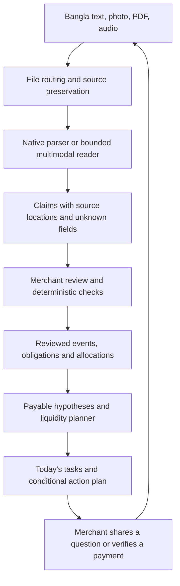

**Shongoti: customer product research and implementation recommendation**

Research date: 22 November 2026, Bangladesh time. Prepared for Quintessence Minus Infinity. This is a product and build plan, not a claim that the proposed features or experiments already exist.

Follow-up: the [website and financial-workflow blueprint](website-blueprint-2026-11-22.md) expands the screen flow and prediction design. It also records a subsequently verified integration restriction: WhatsApp's current policy prohibits debt collection, so generic automated WhatsApp collection must not be assumed available. Eligible invoice messaging requires separate provider/use-case verification.

**Recommended product direction.** Build a Bangla-first daily money desk for small grocery retailers: establish the supplier obligation, identify usable money by payment method and deadline, prepare the smallest useful collection or clarification action, and update the plan when new evidence arrives. Preserve the original supplier-demand reconciliation as the foundation of the payment decision.

Suggested customer promise: **“আজ কাকে কত দেবেন, কোন টাকা ব্যবহার করা যাবে, আর ঘাটতি হলে আগে কী করবেন—প্রমাণসহ দেখুন।”**

The advantage should come from completing this workflow with little merchant effort. An OCR button, four agents, or a large feature list does not establish an advantage by itself.

**What was reviewed, and what remains unknown.**

- Local inputs: `Shongoti_Submission_Answers.md`, `FULL_PROJECT_CONTEXT_FOR_AI.md`, the 16-project collection in `previous Readme.md`, existing judge-readiness notes, the official rulebook, and saved official challenge/rules pages.
- Public research: merchant-payment research, current competitor documentation, current Google model/pricing documentation, document-processing references, a current OCR research paper, and agent/optimization engineering guidance. Sources are linked next to the associated findings below.
- The team currently cannot reach a merchant for interviews or consented records. Therefore workflow demand, frequency of disputes, data-entry tolerance, willingness to pay, and actual financial benefit are **unvalidated hypotheses**.
- Previous project capabilities are described by supplied READMEs. Their code, claimed benchmarks, deployment state, security properties, and each member's individual contribution were not independently audited in this research.
- The live hackathon rules/challenges website could not be retrieved. Event constraints below rely on the local rulebook revised 12 November and saved official webpages. Organizer updates may supersede them.

**Evidence that changes the product decision.**

| Observed evidence | Product implication | Limit on the conclusion |
|---|---|---|
| MSC's 14 May 2026 account describes supplier cash requirements, trapped digital balances, fees, and the importance of timely confirmation and reconciliation. | Treat amount, payment channel, availability time, and confirmation as separate fields. | This supports the problem class; it does not establish that merchants will adopt Shongoti. |
| TallyKhata documents customer/supplier balances, messages, payment reminders, reports, and backup. | These are expected conveniences, rather than sufficient differentiation. | Documentation does not prove the absence of adjacent features. |
| Vyapar documents billing, stock alerts, cash/bank records, reminders, reports, and offline functionality. | Adding a complete shop-management suite creates substantial overlap and build cost. | Indian workflows and payment rails do not establish Bangladesh product fit. |
| Dext's supplier-reconciliation help article is dated 20 October 2026. | Supplier reconciliation itself is an existing category. | Shongoti must demonstrate its specific improvement with local informal evidence and decisions. |
| Intuit's current Payments AI documentation includes payment-method suggestions, reviewed reminder schedules, editable messages, and document/photo invoice autofill. | “AI reminds debtors” is already a commercial capability. | The documented feature has US/product eligibility restrictions; it is an adjacent benchmark, not evidence of Bangladesh availability. |
| bKash describes different PRA routes, fees/limits, and business onboarding. | Account type and allowed routes belong in the planning model; integrations require verified access. | A payment gateway does not imply permission to read every personal wallet balance/history or move arbitrary funds. |

Sources: [MSC merchant supply-chain research, 14 May 2026](https://www.microsave.net/2026/05/14/why-bangladeshs-supply-chains-still-run-on-cash-despite-digitization/), [underlying MSC study page, 26 September 2025](https://www.microsave.net/2025/09/26/scoping-study-to-support-the-bangladesh-bank-to-scale-digital-transactions-in-bangladesh-2/), [TallyKhata features](https://www.tallykhata.com/en/khata-features/), [Vyapar business-management features](https://vyaparapp.in/business-management-software), [Dext supplier reconciliation](https://help.dext.com/en/articles/794128-how-to-review-and-reconcile-supplier-statements-in-dext), [Intuit Payments AI](https://quickbooks.intuit.com/learn-support/en-us/help-article/intuit-assist/get-started-payments-agent/L0FyKj9NL_US_en_US), [bKash PRA](https://www.bkash.com/en/page/personal-retail-account), [bKash business onboarding](https://www.bkash.com/en/business/online-business).

Inference from these sources: a promising position is **evidence-aware settlement connected to time- and channel-specific liquidity planning**, delivered through simple Bangla capture. This combination is a hypothesis to demonstrate, not a verified world-first or proof that competitors cannot do it.

**Choose one initial customer and one recurring job.**

Start with an owner-operated grocery shop that buys on supplier credit, accepts some digital payments, extends some customer credit, and retains at least a few records. The recurring job is: “Help me prepare today's collections and supplier payments without spending tomorrow's essential stock money.”

Avoid starting with every business type. Pharmacy batch/expiry workflows, wholesale credit chains, restaurant ingredients, and manufacturing have materially different requirements. Hardware/wholesale can be a later interview segment if grocery access or evidence proves unsuitable.

The product is useful on a normal day through due tracking and capture; the original dispute feature becomes useful during collection. This daily entry point is intended to reduce dependence on an occasional dispute, but retention is not established yet.

First-use setup should need only an opening money snapshot, one supplier demand, and optionally a few customer dues. Do not require a full historical ledger or product catalogue. If the opening snapshot is absent or stale, show the reconciliation result and request the missing cash information before issuing a liquidity plan.

**A day in the proposed product.**

| Moment | Merchant action | Useful output |
|---|---|---|
| Opening | Confirm cash, bKash/Nagad/bank balances, today's obligations, and essential restock reserve. | A time-stamped view of what can actually be used today. |
| During sales | Say “রহিম ৫০০ টাকা বিকাশে দিল, আগের বাকি থেকে” or enter a quick form. | A reviewable proposed receipt linked to the right party; one confirmation before posting. |
| Before a supplier visit | Add the demand, relevant receipts, return slips, and selected messages/audio. | Supported payable or one decision-changing unresolved question. |
| Before a predicted shortfall | Open the recommended action. | Ask for an already-due payment in a useful channel, consider a permitted cash-out, or ask the supplier about an alternative method. |
| After a reply | Import/paste the reply or record the call outcome with its source type. | Updated promise/constraint and a recomputed plan. |
| After actual receipt/payment | Verify the transaction and approve the posting. | Updated wallet balance, allocation, and remaining obligations. |
| Closing | Count cash and compare with recorded movements. | A discrepancy to review and tomorrow's known dues; a discrepancy is not an accusation of theft. |

The home screen should have three priorities: **আজকের টাকা**, **আজকের করণীয়**, **হিসাব যোগ করুন**. Each task should explain its amount, deadline, source, and next action. Put technical traces in a separate reviewer view. A chart alone is not an action.

**Feature priorities tied to customer value.**

| Feature | Customer benefit | AI contribution | Priority |
|---|---|---|---|
| Supplier demand check, including reused receipts and accepted returns | Avoid an unsupported payment or repeated deduction | Interpret informal evidence and distinguish receipt from prior inclusion | P0, original core |
| Cash/bKash/Nagad/bank positions with snapshot age | See usable money rather than one misleading total | Interpret an imported statement or voice correction when needed | P0; balances are calculated in code |
| Due and promise timeline | Remember who owes what, when, and through which channel | Extract partial promises, negation, conditions, aliases, and revised dates | P0 |
| Shortfall alert and next-action plan | Act before the supplier's deadline | Obtain structured meaning from messages; explain a computed plan | P0; alert and optimization are deterministic |
| Bangla text/photo/PDF/audio capture with review | Reduce typing and preserve original evidence | Document reading and contextual speech understanding | P0, bounded file sizes/types |
| Collection/clarification drafts and reply update | Make one useful follow-up and keep its context | Ask the missing question and interpret the reply | P0, merchant shares in the demo |
| Day-end cash count and corrections | Detect missing entries and begin the next day accurately | Categorize an explanatory note if needed | P1 |
| Accepted-return/credit follow-up | Avoid forgetting a supplier credit | Interpret acceptance and later application | P1; partially covered by the original core |
| Essential restock list and spending what-if | Protect known replenishment needs | Parse a supplier quotation or merchant note | P1; no demand forecast without sales data |
| Reviewed alias and supplier-term memory | Avoid asking the same setup questions repeatedly | Suggest matches, requiring review | P1 |
| Shareable settlement brief and readable audio summary | Explain a payment in familiar language | Optional narration and drafting | P1; do not put TTS ahead of core correctness |
| Full SKU inventory, stock forecasting, loan underwriting, tax/payroll, autonomous payments | Potential later expansion | Requires substantially different data and validation | P2, outside the hackathon cut |

P0 does not mean six separate large subsystems. Implement a single case/event flow that powers the wallet, timeline, tasks, and settlement views. A short reviewed entry is always available when parsing fails.

**The friend's example, modeled correctly.**

Illustrative inputs, not a merchant observation: cash BDT 0, Nagad BDT 5,000, bKash BDT 2,000. A supplier needs BDT 1,000 in cash by 16:00. Karim owes BDT 1,500 and previously said: “তিনটার মধ্যে এক হাজার নগদ দিতে পারব, বাকিটা শুক্রবার।” Another customer owes BDT 4,000 but can pay by bKash tomorrow.

The aggregate balance is BDT 7,000, yet immediately available cash is zero. The system first checks whether the supplier can accept an already-available digital method. If not, it considers a permitted cash-out, including fees, account rules, actual availability, travel/settlement time, and any reserve. It should not pressure a debtor when an easier acceptable route exists.

If collection is useful, Karim is relevant because the partial amount, cash channel, and promised time align with the shortfall. The customer offering bKash tomorrow does not solve today's cash-only deadline. A reminder can request fulfilment of Karim's existing due/promise; Shongoti must not invent an accelerated debt obligation.

Karim's words become `promised BDT 1,000 cash by 15:00`, not `cash received`. If the money actually arrives and the owner verifies it, cash becomes BDT 1,000. If the supplier is paid, cash becomes zero. To also protect a BDT 500 physical-cash reserve, this collection is insufficient: another BDT 500 or a different agreed plan is needed. The engine must show that shortfall rather than reuse the same BDT 1,000 twice.

If Karim delays, the collection scenario fails and the engine offers the still-feasible alternatives or reports that no feasible plan is established. A requested supplier extension changes a deadline only after the supplier accepts it. A future repayment is never guaranteed simply because an LLM says the customer is reliable.

Keep three visibly different states: **money available now**, **money promised**, and **a scenario being considered**. Even available-now money depends on the freshness and verification of the recorded snapshot; it is not a guarantee about an unconnected wallet.

**Preserve the original bill logic in full.**

Current demand BDT 25,000; valid linked payment BDT 4,000; accepted linked return credit BDT 3,000. Before knowing what the current demand already includes, there can be four supported hypotheses:

| Prior inclusion in the demand | Remaining payable |
|---|---:|
| Both already included | BDT 25,000 |
| Payment included; return omitted | BDT 22,000 |
| Return included; payment omitted | BDT 21,000 |
| Both omitted | BDT 18,000 |

This table applies only after eligibility/linkage and return acceptance are established. A BDT 4,000 receipt fully used on another invoice must not enter this table as a fresh credit. A supplier saying “৪১-এর চার হাজার পেয়েছি। ফেরতের তিনটা এখনও বাদ দিইনি” establishes receipt and return omission, but does not establish payment inclusion. Ask only whether that payment was already deducted from today's demand; the surviving results are BDT 22,000 and BDT 18,000.

Liquidity planning runs against these hypotheses separately. Until the obligation is resolved, do not publish one apparently affordable payment as the confirmed amount owed. The reserve can reveal a shortfall; it cannot reduce the supplier's valid claim.

**A precise response to “this is just math.”**

Agree with the premise for arithmetic. Subtraction, due-date comparisons, overdue alerts, fees, allocation capacity, balance updates, and payment-route optimization belong in deterministic code. Shongoti's AI value must be measured in transforming messy evidence into accurate reviewed facts and resolving the uncertainty that changes a decision.

Examples that require interpretation rather than more arithmetic:

- “টাকা পেয়েছি” versus “এই দাবিতে টাকা বাদ আছে”: different propositions.
- “শনিবার বিকাশে হাজারটা, বাকিটা মাল বিক্রি হলে”: partial payment, method, time, and a contingent remainder.
- “নগদ” can refer to physical cash or the Nagad brand in context. Ask if the distinction changes the plan and is not clear.
- A phone screenshot and a voice note can refer to different bills even when amounts match.
- “আগের কথা বাদ, শুক্রবারও পারব না”: a prior promise may be retracted, not strengthened by the new message.
- A missing fact can block an obligation, while another missing fact only affects which collection action is useful.

An LLM cannot recover a fact nobody recorded. An additional agent cannot create independent ground truth. If clean structured records already exist, the financial result should be computable with zero LLM calls. This is an efficiency property, not a weakness.

Suggested judge answer: “হিসাবটা আমরা কোড দিয়েই করি। AI বোঝে বিল, কথার শর্ত, কোন পেমেন্ট কোন বিলের এবং কোন প্রশ্নের উত্তর ছাড়া সিদ্ধান্ত নেওয়া যাবে না। একই রেকর্ডে rules-only-এর সঙ্গে আমরা ভুল, review effort, সময় ও খরচ তুলনা করি।” Use the last sentence as a completed claim only after running the comparison.

**AI routing and agent scope.**

Use the original Reader, Reconciler, Skeptic, and Clarifier as conditional roles. Do not run four full conversations for every sale. Normal reviewed entries use code; a new ambiguous source uses Reader/Reconciler; conflicting or consequential interpretations trigger Skeptic; a fact blocking the decision triggers Clarifier. These are workflow roles on models, not four independently validated experts.

A bounded agent may choose to inspect a referenced source, retrieve a party's reviewed allocation history, request clarification, or submit a proposed interpretation. A scheduler and deterministic planner decide when a known due becomes relevant. Posting money, contacting someone, and accepting a changed supplier term require the appropriate merchant approval.

The Skeptic must inspect source claims and allocation capacity, not just endorse a persuasive explanation. Treat its agreement as another model judgment. Useful engineering guidance is to start with simple model calls and add orchestration only where it improves measured performance; additional agent steps trade latency and cost for possible quality. [Anthropic engineering guidance](https://www.anthropic.com/research/building-effective-agents).

**Technical architecture sized for this team and deadline.**

Recommended implementation: React/TypeScript mobile web frontend, one FastAPI service, PostgreSQL, private file storage, and one bounded background-job mechanism. This matches the supplied experience and keeps parsing/optimization in Python. If the team already has a new event-compliant TypeScript backend underway, keep it; do not rewrite a working stack to match this recommendation. No new graph server or vector database is needed for the initial small corpus. Represent evidence relationships in relational tables and retrieve by exact transaction IDs, party IDs, invoice references, and dates before considering semantic search.

Core records:

| Record | Essential contents |
|---|---|
| Source | Merchant, original file/text, hash, media type, upload time, selected document date, processing/version metadata |
| Source span | PDF page and text/box where available; image crop; audio segment/transcript with checked alignment where available |
| Claim | Type, amount/currency, party candidates, invoice candidate, time/method, source span, uncertainty, reviewed status |
| Obligation | Payable/receivable amount, due window, allowed methods, supported terms, disputed portion |
| Money snapshot | Account type, balance, as-of time, source/verification state |
| Promise | Who, amount, method, time, condition, source, retraction/supersession status |
| Financial event | Actual reviewed receipt/payment/return/expense/transfer; append-only corrections and balanced ledger postings |
| Allocation | Which verified event is applied to which obligation, amount and remaining capacity |
| Plan | Input versions, conditions, route choices, fees, deadline/reserve results, expiry and unresolved facts |
| Action | Draft or approved follow-up, recipient, due time, status, cooldown and idempotency key |
| Audit | Reviewer, original/proposed/corrected values, source references, model/version and token/time usage |

Store money as integer paisa or exact decimals, never floating-point balances. Separate when an event happened, when it was recorded, and when funds become available. Resolve dates in Asia/Dhaka and retain the original phrase. Do not assume an account supports a route merely because its brand name is recognized.

Hard invariants to implement and test:

1. A payment's total allocations cannot exceed its verified value; partial allocations remain possible.
2. Receivables and promises cannot increase an available-now wallet balance.
3. No unsupported credit reduces a confirmed supplier obligation.
4. Each posted movement has balanced ledger entries, including transfers and their separate fees; transfers do not create revenue.
5. A plan cannot use the same money twice across obligations or time steps.
6. Route-specific fees, limits, accepted methods, reserves and availability times must be respected.
7. Failed parsing or missing evidence produces review/unknown states, not zero amounts or fake successful AI output.
8. Approvals refer to a specific case/snapshot version. A changed source or balance invalidates the affected approval/plan.
9. Concurrent approvals and repeated uploads cannot double-post a movement. Enforce this in a database transaction, not in prompts.
10. A document or message is data, not instructions to the agent; it cannot authorize a write or select an external recipient.

A content hash helps identify unchanged content and trace revisions. It does not authenticate a receipt, establish payment settlement, or prove a document's truth. Likewise, a provider-call receipt demonstrates a call ran, not that its interpretation was correct.

**How to make OCR, PDF and audio genuinely useful.**

| Input | Initial processing choice | Financial review requirement |
|---|---|---|
| Native text PDF | Local text/page extraction first; layout-aware parser only where needed | Inspect amount/date/invoice references, including visual rendering where the text layer is suspicious |
| Scanned PDF or bill photo | Quality check, crop/rotate, then multimodal read | Show the source crop beside proposed amount, party and invoice; allow recapture and correction |
| Table-heavy statement | Preserve rows/columns; evaluate Docling or a bounded visual reader | Check opening/closing balances and repeated headers; do not flatten unrelated rows into one claim |
| Voice recording or uploaded voice note | Transcribe plus structured event/promise extraction | Replay the relevant clip; confirm amount, person, cash versus Nagad, date, condition and negation |
| Mixed record bundle | Link candidates using exact references and reviewed history | Preserve contradictions; similar amount or spelling alone is insufficient |

Google currently documents native PDF understanding and audio input, and both recommended model candidates support structured outputs. These are capabilities, not evidence of reliable Bangla shop handwriting, dialect recognition, or correct bookkeeping. [PDF documentation](https://aistudio.google.com/docs/document-processing), [audio documentation](https://aistudio.google.com/docs/audio), [structured-output documentation](https://aistudio.google.com/docs/structured-output).

For an advanced document backend, Docling represents layout/provenance, while PaddleOCR-VL-1.6 is a June 2026 document-parsing research candidate. Evaluate on our actual fixtures before choosing; its general benchmark score is not a Bangla merchant accuracy result. Do not add a heavy self-hosted model merely for a feature badge. [Docling document model](https://docling-project.github.io/docling/concepts/docling_document/), [PaddleOCR-VL-1.6 paper](https://arxiv.org/abs/2606.03264).

If direct multimodal audio fails on Bengali numerals or shop noise, test a dedicated ASR adapter. Google's current language table lists `bn-BD` with region/model-specific support, including Chirp 3 in EU/US and Chirp 2 in asia-southeast1. Region and feature availability matter. [Cloud Speech-to-Text language table](https://docs.cloud.google.com/speech-to-text/docs/speech-to-text-supported-languages).

Do not invent precise bounding boxes or word timestamps from a summary model. If exact alignment is unavailable, link the page or short recording and ask for review. Never label a self-reported LLM confidence as a calibrated probability. Numeric fields need explicit validation; they must not be exempt merely because they look copied from a document. Handwriting and Banglish support require local testing; English-only OCR/NLI choices from previous projects are not a drop-in Bangla solution.

**Liquidity engine and explainable next actions.**

The planner's state is money per account per cutoff, with due obligations, reserves, known route fees/capacity/settlement time, and separate conditional inflow scenarios. At each cutoff: previous available balance + eligible realized inflows - payments - transfer debits - fees = new available balance. Transfer arrivals are credited at their actual permitted availability time.

Compare options such as an accepted existing digital payment, a permitted cash-out, fulfilling an already-due customer promise, and a supplier-approved reschedule. Protect mandatory constraints first; then compare fee cost, contact burden, and chosen reserve preferences transparently. A reserve that conflicts with a valid obligation produces an infeasible plan or a request to change terms, not a smaller invented debt.

For the small demo, enumerate a bounded set of routes and scenarios, then independently replay the selected result. If combinations grow, use OR-Tools CP-SAT for fixed fees, discrete actions and deadline/method constraints. All its constraints require integer formulation and solver status must be shown honestly: feasible does not always mean optimal, and unknown does not mean infeasible. [OR-Tools CP-SAT documentation](https://developers.google.com/optimization/cp/cp_solver).

For incomplete evidence, prefer a conservative now-only plan and clearly labeled promise scenarios. Do not issue a default probability such as “Karim will pay with 92% confidence.” A statistical collection/stock forecast requires appropriate history, evaluation and calibration that this team does not currently have.

The next question should target a fact that changes feasibility, payable amount, or the best action. Show the consequence, for example: “আজ cash লাগবে নাকি bKash নেবেন? bKash নিলে cash-out প্রয়োজন থাকবে না।” This is more useful than generating many generic questions. A first implementation can rank the difference between enumerated feasible outcomes without fabricating answer probabilities.

**Current model choice and cost discipline.**

As inspected on 22 November 2026, Google lists stable `gemini-3.8-flash` and `gemini-3.1-flash-lite`, both accepting text, images, audio and PDF. Use 3.8 Flash as the initial quality reference and test whether 3.1 Flash-Lite is adequate for simple extraction. Final selection depends on real requests, quotas, financial-field errors, latency and total billed usage, not a model-family slogan. [3.8 Flash model](https://aistudio.google.com/docs/models/gemini-3.8-flash), [3.1 Flash-Lite model](https://aistudio.google.com/docs/models/gemini-3.1-flash-lite).

Current listed Standard paid rates per million tokens: 3.8 Flash input USD 0.75 and output USD 3.75 through 31 December 2026; listed rates increase from 1 January 2027. Flash-Lite input is USD 0.25 for text/image/video and USD 0.50 for audio, with output USD 1.50. Thinking tokens contribute to billed output. Confirm the provider's actual usage and modality accounting in the chosen request path. [Google pricing](https://aistudio.google.com/docs/pricing).

Illustrative arithmetic, not a measured case cost: 8,000 billed input tokens and 1,000 billed output tokens on 3.8 Flash cost USD 0.00975. The same text/image token counts on the listed Lite rates cost USD 0.0035. Four identical full passes would multiply that cost approximately fourfold. Real images, audio, thinking, retries, storage, hosting and communications change the total.

Cache unchanged source interpretation by content hash plus parser/model/prompt version. Do not reuse a final plan simply because its source files are unchanged: balances, allocations, terms and deadlines may have changed. Batch background tasks where appropriate; put immediate merchant work ahead of optional narration. Record dollars/case, calls/case, p50/p95 latency, review corrections and API failures. A scheduled due-date scan and ordinary arithmetic must cost zero model tokens.

Financial records contain private information. Use synthetic/redacted demo data, minimize transmitted context, and select an appropriate data-use tier before a real pilot; Google's pricing page distinguishes free and paid data-use treatment. Account isolation, private storage, revocable access and delete/export controls matter when onboarding real shops. Native Web Speech voices are not automatically offline or zero-egress simply because the browser exposes them.

**What the previous 16 projects suggest about team fit.**

| Project | Relevant experience described in the supplied README | Application to Shongoti / boundary |
|---|---|---|
| GridWise | Natural-language directives, deterministic guardrails, constrained optimization, independent replay | Most direct technical blueprint for the interpretation/planning boundary. Do not silently ignore critical payment terms when the model fails. |
| DevPsyche | Interactive UI and presentation | Use clear visual hierarchy; a 3D visualization does not help a busy merchant settle a bill. |
| AI Document Q&A Bot | PDF ingestion, chunking, document-filtered retrieval | Useful ingestion knowledge; financial allocation needs exact records beyond semantic Q&A. |
| Support Triage Agent | Tool routing, retrieval, escalation and grounding | Bound the clarification loop. Weighted model self-confidence does not establish calibration. |
| HealthTwin AI | Bilingual voice and explicit safety gates | Useful interaction pattern; do not transfer medical safety guarantees or English retrieval assumptions. |
| Pathwarden | Provenance relationships, external-action gates, replay and visible fallbacks | Trace source-to-claim-to-action and isolate writes. A separate graph database is optional here. |
| PSL Document Intelligence | Native/scan routing, citations, edit history, parser tradeoffs | Source inspection and reviewed corrections. Its English-only assumptions and numeric-verification exemption are unsuitable as-is. |
| Synapse | Decisions/promises/deadlines, permission-aware memory, supersession | Remember current supplier terms and customer promises, with explicit authority and source review. |
| Lights, Fans, Discord | Event streams, alerts, live dashboard and fallback behavior | Recompute tasks after a changed payment/reply. Simulated balances must remain labeled. |
| UNDERWRITE | Allocation/replay controls, bounded financial authority, adversarial evaluation | Apply the principle of limited model authority; do not import old project code, custody, token or blockchain machinery. |
| VERITAS-600 | Cross-document fields, deterministic money/date checks, source inspection | Strong fit for linked bills/receipts and visible source locations; bank/legal rules are out of scope. |
| Ebarki | Native PDF, images/scans, audio, traceable payment discrepancies and review | Closest customer-facing input/review pattern. Shongoti needs a different daily merchant workflow, newly implemented. |
| Subtext AI | Explicit versus inferred requirements, phrase grounding, client memory, clarification | Preserve what a message actually establishes and ask about implications rather than assume them. |
| Claim-Check MCP | Atomic claims and honest abstention in voice | Separate claims such as received/included/accepted; verify financial evidence rather than Wikipedia. |
| AI5K Profile Intelligence | Source spans, replaceable parsers, modular monolith, explicit scaffold disclosure | Keep parser backends replaceable and model output traceable. Stub outputs are not working AI. |
| ClauseGraph | Context-linked actions, recursive dependency views, reports and briefings | Explain how one corrected payment changes dependent tasks. Hashes do not prove authenticity or product-wide privacy. |

This is evidence of relevant described experience, not a license to claim these systems' benchmark results for Shongoti. The hackathon requires a new eligible project repository and new project code. Transfer understanding and design lessons; build and measure the new implementation.

**A comparison that can answer the judge's AI objection.**

Create the already-proposed 24 paired stories / 48 cases, now covering the extended workflow. This benchmark has not been built or run as part of this research. Use a small subset for development and keep story families together when separating held-out cases, so a paraphrase of the same bill story cannot leak across splits.

Include duplicate/reused transfers, partial allocation, payment received versus already deducted, accepted versus unaccepted returns, cash versus Nagad ambiguity, retracted/conditional promises, delayed receipts, channel-only shortages, fees/reserve infeasibility, stale snapshots/approvals, conflicting dates, poor photos and audio numerals. Include straightforward controls and missing/no-reply cases.

Compare on the same source bundle and the same accounting/planning tools:

| System | Question answered |
|---|---|
| A. Native/OCR/ASR extraction + rules/matching | What can a serious non-LLM reasoning baseline do? Disclose that OCR/ASR itself may use machine learning. |
| B. One model + identical tools and review controls | Is role orchestration adding anything beyond a capable single model? |
| C. Conditional Reader/Reconciler/Skeptic/Clarifier + identical tools | Does extra reasoning improve useful correctness enough to justify cost and latency? |
| D. Gold structured facts + deterministic engine | Are errors in perception/interpretation or in arithmetic/constraints? This diagnostic is not an end-to-end competitor. |

Use both a raw-input comparison and a shared-extraction comparison if time permits. The first measures the whole system; the second isolates reasoning. Avoid claiming B is worse because it was denied tools C received.

Measure:

- Exact critical-field accuracy: amount, polarity, party/invoice link, time and payment method; keep OCR/ASR errors visible.
- Final payable correctness and absolute monetary error against independently reviewed answers.
- Unsupported finalization, duplicate allocation and infeasible action-plan counts.
- Useful supported completion and appropriate unresolved decisions, reported together. Refusing everything is not success.
- Whether the first clarification separates surviving decisions and whether partial replies change only supported facts.
- End-to-end latency, billed cost, number of calls, corrections, and observed operator review time.
- If two teammates perform scripted review, report it as a lab comparison, not merchant time saved.

Gold answers should be checked by a teammate who did not write the story. State ambiguity in the gold labels. Preserve failures, attempted-case denominators and exact provider/model versions. Deterministic guard failures must block release; any observed unsupported monetary finalization requires correction before the demo. Zero observed errors in a small synthetic set is not a real-world guarantee.

If C does not improve the relevant error/coverage measures enough to justify its additional cost, ship B for those paths. If A handles a case correctly, route that case through A. Actual evidence for selective AI is more defensible than insisting that every path needs agents.

**Demo story that exposes the technical value.**

1. Introduce a fictional shop and label all records synthetic. Show multiple wallet positions, including their timestamps, and a supplier deadline.
2. Upload a bill PDF, a payment screenshot and a short Bangla voice recording through the real parsers/models. Make the raw evidence visible.
3. Show the original supplier puzzle: one similarly sized receipt belongs to an older invoice; receipt does not establish prior deduction. Ask the specific inclusion question.
4. Add a clear or partial answer. Update the payable hypotheses, preserving unresolved facts where appropriate.
5. Show why an aggregate positive wallet balance can still leave a channel-specific shortfall. Compare an existing accepted payment route before asking debtors.
6. Interpret an already-due customer's partial, time-limited promise and prepare one editable follow-up. Sharing is manual in the hackathon; do not claim a live messaging integration.
7. Add an actual reviewed receipt or a no-payment/delay outcome. Recompute the plan; only an actual receipt affects available-now money.
8. Change one input, such as “cash” to “bKash tomorrow,” in front of the judge. The affected plan should change from the real data, not from prewritten AI responses.
9. Open the source and the independent replay checks. Briefly show measured baseline/cost results, only if completed.

Keep the primary story within three minutes, then offer source/engine inspection. Have local data and a network-backup recording, but distinguish them from live AI execution. Synthetic input is legitimate; simulated or prerecorded AI output must not masquerade as a live result.

**Build plan for the remaining event window.**

The following assumes the team was shortlisted, has submitted the idea, and can work during the permitted period. Do not infer those administrative facts from this document.

| Window | Shared outcome | Member A: financial engine | Member B: ingestion/AI | Member C: merchant workflow |
|---|---|---|---|---|
| 22 Nov, first working block | Contract and one working vertical slice | Money/event/allocation schema, reviewed posting, original four hypotheses | Claim JSON contract; one real image or PDF read | Opening snapshot, upload/review, settlement card |
| 22 Nov, next block | Original bill scenario works end to end | Duplicate/capacity checks, independent replay | Received/included/return states, source linkage and unknowns | Source review, correction, approval/version handling |
| 23 Nov, first block | Daily-money extension works | Method/time/reserve planner and changed-input recomputation | Bangla voice promise extraction and focused clarification | Wallet/time/tasks view, draft/share, reply import |
| 23 Nov, next block | Reviewable deployed candidate | Concurrency/idempotency and impossible-case checks | Provider timeout, quotas, latency/cost capture | Public deployment, test access, responsive/touch review |
| 23 Nov, final block | Evidence for the pitch | Run critical invariant/evaluation cases | Run fair baseline comparisons | Prepare short demo, README disclosures and backup |
| 24 Nov, on-site five hours | Finished and submitted project | Fix observed engine failures | Test novel live input and provider failures | Finish live UX, verify public links and submit before cutoff |

Work by integration contracts, not three disconnected feature demos. Agree on claim/event states before expanding screens. Reserve time for deployment and real model calls; no plan is complete while those remain untested.

If time becomes tight, cut full inventory, voice narration, statistical forecasts, real payment/messaging integration and a separate graph UI first. Preserve: original reconciliation, one usable-money plan, photo/PDF plus a short audio path, editable action, source review, actual balance update, and a changed-input/no-reply demonstration. If only one or two members are available, reduce the number of input paths before weakening accounting checks.

**Hackathon constraints that affect the plan.**

From the local rulebook: project-specific code starts only from 21 November after selection; one public repository is created on/after that date with its first code commit on/after that date. Old/submitted projects cannot be reused. Registered members do the work; AI coding assistants, public APIs and open-source libraries are allowed with disclosure/credit. The final is on 24 November for five continuous hours; maintain each member's contributions and at least hourly commits during the final. Do not rewrite history.

Keep the original supplier-settlement proposition visible so the expanded product remains explainable as a continuation of the submitted idea. The documents reviewed do not establish that a broad idea change is preapproved. If the actual submitted proposal differs materially, examine the organizer's current instructions rather than assuming permission to replace it.

Final submission needs public project/repository links or the rulebook's permitted deployment alternative, test login if needed, and model/tool disclosures. As of this plan's date, the saved schedule puts the shortlisted-team BDT 1,350 payment deadline at 23 November 23:59 Bangladesh time. Registration, shortlist, payment and final confirmation were not checked here.

Local references: [official rulebook](official-rulebook.pdf), [saved official rules](official-rules-snapshot.html), [saved official scoring rubric](official-challenges-snapshot.html). The rubric weights are problem relevance 20, innovation 25, AI application 25, feasibility 15, potential impact 15. A strong pitch should connect each criterion to observed implementation/evaluation evidence rather than award itself a predicted score.

**How to move toward real customers after the hackathon.**

The immediate honest claim is a working prototype for a research-supported problem class. It is not yet a customer-validated business.

When access becomes possible, observe three to five retailers handling their latest supplier collection; record what evidence exists, what their current call/ledger process solves, and what remains costly. Start with a consented seven-day diary of opening balances, due events and corrections. Ask merchants to use the one-bill workflow before asking them to migrate history.

Measure how often they voluntarily return, minutes spent capturing/reviewing evidence, how many prompts/clarifications are needed, whether recommended actions are feasible, and confirmed monetary corrections. Count only new, valid, actually applied corrections; do not treat every disputed credit as money saved. Ask about willingness to pay after useful completion, without suggesting that interview enthusiasm is a purchase commitment.

Pricing and business model remain hypotheses. A small monthly merchant subscription or distribution through a bookkeeping/payment partner can be tested later. There is no evidence here for a particular BDT price, a take rate, a lending model or a guaranteed revenue opportunity. A partner integration should depend on verified API access, customer permission and a demonstrated workflow benefit.

If merchants find review slower than their existing call, simplify to capture plus a precise question or narrow the segment. If they cannot keep balances fresh, avoid proactive liquidity claims and focus on settlement evidence. If disputes are rare but due tracking is used daily, prioritize low-effort money capture while retaining reconciliation as a differentiated task. If a strong single model is enough, reduce orchestration. These are product decisions to make from observations, not failures to hide.

**Decision to take now.** Keep Shongoti's original evidence-backed supplier reconciliation. Add a tightly connected daily workflow for usable money, due promises, channel/deadline shortfalls and reviewed next actions. Demonstrate the complete loop with real inference and deterministic accounting. Treat the large feature catalogue, statistical forecasting and automated financial integrations as later decisions requiring evidence.
