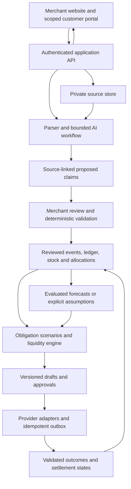

**Shongoti — canonical build plan for Antigravity**

**23 November extension:** The application now has implementation. This file preserves the original domain contract and Phase 00–12; statements below about the initial empty handoff are historical. Continue the user's approved additive Phase 13–26 under [EXTENSION_PLAN.md](EXTENSION_PLAN.md) using [START_EXTENSION.md](START_EXTENSION.md), current source and both trackers. Do not rebuild the project or interpret this document's original “not implemented yet” statements as the current runtime state.

Prepared 22 November 2026, Asia/Dhaka. Repository: `https://github.com/sakibul-shovon/Shongoti.git`.

This is the implementation contract and full product context. Start here together with `AGENTS.md` and `docs/PROGRESS.md`. The team wants the complete merchant product described below, delivered in verified phases. A UI preview, written test fixture, mocked call or plausible model answer does not mean the application feature is complete.

**A. Current state and authority**

- Phase 00 prepares this handoff. No application implementation, database, deployed service or real AI/payment integration is claimed.
- The remote was originally observed empty and private, created `2026-11-22T17:29:52Z`. `origin` is connected. The user now mandates and authorizes commit plus push after every verified phase to this repository. Visibility changes, deployment and unrelated external actions are not included.
- The parent workspace is a reorganized research workspace. Its full verified backup is outside this project in `../archive/`; do not modify or import its caches/toolchains.
- Full product/domain context follows the execution phases in this same file. `docs/context/` supplies historical evidence, not competing implementation instructions.
- Use user instructions first, then this current plan and `AGENTS.md`. Record explicit design decisions instead of silently choosing contradictory historical scope.
- Root `AGENTS.md` is a supported Antigravity workspace rule location according to current official documentation: https://antigravity.google/docs/rules/ . Open the actual `Shongoti` folder as the workspace so these instructions are discoverable.

**B. Session and progress protocol**

At session start, inspect the working tree, actual source/tests, available history, branch state and fetched remote refs. Read both trackers and Git checkpoint records. Establish the last genuinely verified and published phase, identify partial/blocked work, repair stale progress claims with reasons, and select the next exact unblocked task. Preserve existing work and do not redo verified phases. A checkbox or commit message alone is not completion evidence.

Valid states: `not_started`, `in_progress`, `blocked`, `complete`. Use task IDs in every progress entry. A phase is complete only when every task's gate is supported by observed evidence AND its milestone and checkpoint-receipt commits are verified published on origin. Tasks that are merely scaffolded, documented or mocked remain incomplete for their real execution gate.

Store sanitized evidence under `docs/evidence/phase-XX/`. A result record contains task ID, check ID, actual command, working directory, UTC run time, code revision/tree context, exit code, mode (`offline`, `mock`, `sandbox`, `live`, `browser`), observed outcome, summary and evidence paths. Never write a fake exit code or execution time. Use `not_run` with a reason when a check was not run.

Update `docs/progress.json`, `docs/PROGRESS.md`, `docs/KNOWN_ISSUES.md` and any relevant integration/decision state before ending a session. Leave the next exact task and reproducible commands. After EVERY verified phase, including Phase 00, create a milestone commit with footer `Shongoti-Phase: XX`, push normally to the intended branch on origin, verify the remote commit, record the observed milestone SHA/publication in a checkpoint receipt and trackers, commit/push that receipt, and verify the final local tip is published before advancing. Follow `docs/GIT_CHECKPOINTS.md`. The user already authorized these routine phase commits/pushes. Preserve history and unrelated work; do not request permission again for routine checkpoints. A push failure leaves the publication gate blocked, never complete.

If a provider, credential or browser is missing, record the exact blocked gate and setup required. Continue independent authorized tasks whose dependencies permit it. Do not mark the parent feature fully complete, substitute demo success, weaken a golden expectation or silently remove the feature. A later phase may begin only when its actual prerequisites are available; bypassing a financial invariant gate is never acceptable.

**C. Runtime and command contract**

Preferred stack: React + TypeScript frontend, FastAPI + Python backend, PostgreSQL, private source storage and a bounded worker/outbox. Use a modular monolith. Confirm versions/support against local tools and official documentation during Phase 01; record lockfiles and runtime versions. Observed host tools during handoff: Node `v24.20.0`, Python `3.12.15`, Git and pnpm available. These observations do not establish Docker, PostgreSQL, browser drivers, deployment capacity or provider credentials.

Target source layout to create, not an existing implementation:

```text
apps/web/                 React/TypeScript merchant and portal UI
apps/api/app/             API, services, domain, persistence, adapters, workers
apps/api/tests/           domain, API, database and boundary tests
apps/api/alembic/         explicit migrations
tests/e2e/                real-browser workflows
tests/fixtures/contracts/ handoff golden cases, already provided
scripts/                  cross-platform task launchers and checks
docs/                     progress, decisions, context and sanitized evidence
```

Phase 01 must create and actually verify these root command interfaces, adapting implementation details while keeping names stable:

| Command | Contract |
|---|---|
| `pnpm dev` | Documented local web/API development entry point |
| `pnpm typecheck` | Frontend and applicable typed contract checks |
| `pnpm test:domain` | Python financial-domain/golden contracts |
| `pnpm test:api` | API and declared database/boundary tests |
| `pnpm test:web` | Meaningful UI behavior tests |
| `pnpm test:e2e` | Real-browser complete workflows |
| `pnpm db:migrate` | Apply explicit migrations to the selected development database |
| `pnpm db:check` | Verify expected migration/schema state |
| `pnpm build` | Actual production frontend/backend packaging checks |
| `pnpm verify:offline` | Required local deterministic/type/build/boundary gates; scope is explicit |
| `pnpm verify:integrations` | Configured real sandbox/live integration gates; missing access is blocked, not passed |
| `pnpm eval:ai` | Genuine provider evaluation with exact cases/model/version/cost; fixtures alone do not pass it |

These commands do not exist yet. Do not claim they ran during the handoff. Establish interpreter/package-manager resolution that works from the documented Windows shell and chosen deployment environment. Avoid Bash-only assumptions. Do not use an unrelated global Python or the archived research environment as the application's dependency lock.

**D. Ordered build phases**

| Phase | Depends on | Intended milestone |
|---|---|---|
| 00 | None | Verified repository handoff, context and golden contracts |
| 01 | 00 | Reproducible skeleton and command contracts |
| 02 | 01 | Exact financial domain before product polish |
| 03 | 01, 02 | Persistence, identity and tenant/role enforcement |
| 04 | 03 | Source capture, review and genuine inference boundary |
| 05 | 02, 03, 04 | Original supplier reconciliation end to end |
| 06 | 02, 03 | Connected merchant transactions and daily position |
| 07 | 05, 06 | Shared-ledger liquidity and spending-impact decisions |
| 08 | 03, 05, 06, 07 | Reviewed actions, scoped portal and one actual connector |
| 09 | 06, 07 | Stock-aware operation, evaluated forecast path and reports |
| 10 | Relevant 04–09 paths | Complete product UI, responsive behavior and failure states |
| 11 | Relevant earlier gates | Fair AI evaluation and release validation |
| 12 | 11 and hosting access | Verified deployment and honest handover |

**Phase 00 — handoff and references**

- P00-T01: Connect the supplied repository and record observed visibility/creation/empty state without remote publication.
- P00-T02: Provide canonical context, agent rules, phase tracking and independent synthetic golden contracts.
- P00-T03: Verify handoff files, links, fixture arithmetic, tracker consistency and secret/cache exclusions; record `docs/evidence/handoff-validation.json`.

Gate: documentation/fixture verification passes. This gate says nothing about future application tests, real inference or provider integration.

**Phase 01 — executable foundation**

- P01-T01: Inventory tools, source, resource limits and official dependency APIs. Record actual versions and choose maintained compatible versions in D004. Identify database/browser/credential gaps explicitly.
- P01-T02: Create web/API skeleton, dependency manifests and lockfiles, configuration validation, health/readiness endpoints and `.env.example` with placeholders only.
- P01-T03: Implement root command contracts, local database startup instructions, a test runner and CI for declared offline checks. A developer must be able to reproduce setup from a clean checkout.
- P01-T04: Build the routed application shell and separate demo entry; initial landing/login/onboarding/today routes may be visibly incomplete until their feature phases. Establish reusable accessible controls and error/loading/empty patterns.

Gate: dependencies install from recorded manifests; API health distinguishes dependency readiness; web builds; one real test is discovered/run; command failures return nonzero; no production route silently returns fixtures. Do not install every future AI/graph library up front.

**Phase 02 — exact financial domain**

- P02-T01: Implement money/currency/rounding, financial event and account types; separate available, pending, obligation, promise and scenario states.
- P02-T02: Implement balanced postings and allocation-capacity checks, partial allocations, duplicate identifiers and append-only reversals/corrections.
- P02-T03: Implement inclusion-aware payable hypotheses and known time/channel/reserve calculations as pure services without model calls.
- P02-T04: Turn `tests/fixtures/contracts/` into executable tests, including failing invalid input and invariants. Independently derive replay checks rather than invoking the same function twice as proof.

Gate: `pnpm test:domain` passes golden cases, exact money is preserved, invalid states fail explicitly and no clean structured case needs an LLM. This is a blocking prerequisite for committing actual financial behavior.

**Phase 03 — database, identity and permissions**

- P03-T01: Implement PostgreSQL schema/migrations for tenancy, accounts, evidence references, claims/review, events/postings, obligations, allocations, promises, scenarios, actions and audits as their modules require.
- P03-T02: Configure real identity/session behavior and tenant membership; isolate seeded synthetic demo tenancy from actual users. Choose D010 explicitly. Optional OTP delivery may remain blocked without a configured sender; never accept an arbitrary phone as verified.
- P03-T03: Enforce owner/cashier/accountant capabilities in server/database paths. Add unique constraints and transactional locks/version checks for duplicate allocation, callback and approval races.
- P03-T04: Test a fresh migration, persist/reload, cross-tenant denial, unauthorized write denial and simultaneous/repeated requests against actual PostgreSQL. SQLite-only tests do not prove PostgreSQL race behavior.

Gate: `pnpm db:migrate`, `pnpm db:check` and relevant `pnpm test:api` pass in the declared database mode. Verified provider credentials are not needed to enforce internal tenancy correctly.

**Phase 04 — evidence ingestion, review and real AI**

- P04-T01: Implement tenant-owned file/text intake, limits, private storage, content hashes, processing jobs and native PDF page/text routing.
- P04-T02: Add replaceable image/scanned-PDF and audio adapters with strict structured claim schemas, source locations where actually supported, explicit null/unknowns and measured bounded retries.
- P04-T03: Implement source inspection, amount/date/party/method corrections and reviewed-claim transitions; a failed parse must never create a zero-value or confirmed event.
- P04-T04: Run real-provider calls on synthetic Bangla bill, message and short audio fixtures; save redacted execution metadata and field-level results. Separately test timeout, invalid schema, unreadable media and unavailable provider boundaries.

Gate: intake/review works persistently; corrections survive reload; mock boundary tests pass; real inference is marked complete only after P04-T04 actually runs. If no key exists, that task is blocked while local intake/review work proceeds. Do not use canned reference outputs as live AI.

**Phase 05 — original supplier reconciliation**

- P05-T01: Implement bill/payment/return linkage, capacity checks and applicability versus prior inclusion as separate facts.
- P05-T02: Preserve the four original BDT 25,000-demand hypotheses, narrow them only from supported facts and exclude the receipt already used on bill 38.
- P05-T03: Implement conditional Reader/Reconciler/Skeptic/Clarifier workflow, exact decision-changing question, reply import and partial/no/contradictory reply behavior.
- P05-T04: Implement reviewed settlement brief and version-bound approval; test live inference plus deterministic tools through the UI/API, not only a seeded result page.

Gate: original golden cases pass end to end, evidence opens, partial replies cannot invent closure, an unaffordable obligation remains the correct obligation, and stale approval cannot write. Do not auto-post model balances.

**Phase 06 — connected daily merchant workflow**

- P06-T01: Implement opening snapshots and as-of freshness, receipts, payments, transfers/fees, expenses, owner withdrawals and actual cash close.
- P06-T02: Implement cash/credit/split sale and invoice/receipt, receivable/payable lists, partial allocation and party timelines. One committed event updates its related records atomically.
- P06-T03: Implement minimal product/stock movements needed for sales/purchases/returns; choose a supported costing scope before any profit claim. Do not infer sales from purchase invoices.
- P06-T04: Connect onboarding/today/money/sales/people screens to real persisted records, with loading/empty/error/permission and correction states.

Gate: a cash sale, credit sale, old-debt collection, transfer fee and supplier payment each produce correct distinct records; reloads preserve state; there is no duplicated revenue or money. The daily dashboard derives values from the same ledger used by the planner.

**Phase 07 — future outlook and decision lab**

- P07-T01: Create versioned planning snapshots from shared ledger/obligations; retain pending settlement, disputes, promises and manual/model estimates as separate inputs.
- P07-T02: Implement account/time/fee/accepted-method/reserve constraints, bounded route/scenario enumeration and independent result replay. Use a solver only if the bounded problem needs it.
- P07-T03: Implement expense, purchase, withdrawal, credit-sale and delayed/partial-collection interventions without mutating actual books. Show first reserve breach, first funding shortfall, affected events and alternative plans.
- P07-T04: Verify the seven-day golden fixture, channel-only shortfall, unchanged actual ledger, realized-versus-promise deduplication and changed-input recomputation in the UI/API. Link reconciled supplier obligations to the actual planner rather than a separate demo fixture.

Gate: exact expected values pass; conditional assumptions are visible; unavailable/unknown solver outcomes are not mislabeled; no "safe to spend" guarantee extends beyond modeled conditions/horizon.

**Phase 08 — actions, customer portal and real connector**

- P08-T01: Implement versioned drafts/approvals/outbox, idempotency, expiry, recipient/amount validation, cancellation and explicit execution outcomes.
- P08-T02: Implement scoped/revocable customer invoice portal, reply/dispute intake and provider checkout initiation boundary.
- P08-T03: Implement one real available connector, initially SSLCOMMERZ sandbox if access exists: session, IPN, server validation, amount/currency/merchant matching, duplicate events, failure/cancel and settlement mapping.
- P08-T04: Reflect verified provider outcomes in exact postings/allocations and recompute relevant plans. Exercise tampered redirect/duplicate callback and at least one actual sandbox lifecycle. Record mode honestly.

Gate: an owner-approved supported task reaches a real verified outcome without double-posting. If credentials are missing, the connector gate stays blocked; in-app/manual/import paths remain useful. Sheets/communications are additional capability-specific tasks, not automatically established by payment success. No unrestricted WhatsApp debt collection.

**Phase 09 — operating features and supported forecasting**

- P09-T01: Complete stock units/counts, purchase drafts, lead-time/stock-cover views, accepted-return follow-up and cost/margin-change calculations.
- P09-T02: Add recurring commitments, stock/cash-aware reorder comparison and reports that correctly separate cash, profit, inventory and dues. Incomplete cost data suppresses unsupported profit claims.
- P09-T03: Implement an optional history-based forecast adapter with simple baseline comparison, rolling-origin evaluation, cold-start/data-quality gating and uncertainty only where evaluated. Synthetic training demonstrates a pipeline, not real merchant accuracy.
- P09-T04: Add supported selected-file CSV/Sheets import/export and optional briefing/printing features, with permissions, deduplication and honest connector state.

Gate: reports tie to ledger and sources; inventory logic uses actual movements; forecasts and promises are not counted twice; model-backed claims have measured evidence. If history/access is absent, complete scenario/operating work and keep the corresponding forecast/connector task blocked rather than calling it finished.

**Phase 10 — product experience and failure quality**

- P10-T01: Finish landing, real/authenticated or explicit-demo entry, minimal onboarding and consistent full navigation. Replace temporary shell placeholders on the declared delivery scope.
- P10-T02: Complete source-to-action interactions on today, future, money, sales, people, reconciliation, stock, inbox, actions, connections, reports and team screens. Actions perform their stated operation or expose a precise unavailable state.
- P10-T03: Browser-verify 360/768/1440px layouts, keyboard/focus/labels, Bengali rendering, touch targets and reduced-motion behavior. Record screenshots and concrete defects/fixes.
- P10-T04: Verify slow loading, poor evidence, no reply, expired session, permission denial, provider down/revoked, stale snapshot and offline draft synchronization. No success toast unless the claimed operation succeeded.

Gate: real browser workflow checks and relevant `pnpm test:web`/`pnpm test:e2e` pass. A screenshot of static data alone is insufficient. If a browser is unavailable, leave the browser gate not_run and do not claim responsive QA passed.

**Phase 11 — independent evaluation and release gates**

- P11-T01: Build the 24 paired stories/48 cases with independent gold review; keep story families together across development/held-out splits. Preserve straightforward and appropriate-unresolved controls.
- P11-T02: Compare rules reasoning, one model with the same tools, conditional roles and gold-fact engine diagnosis. Measure supported completion/abstention, financial error, critical fields, clarification value, time and cost. Record failures/denominators.
- P11-T03: Run deterministic, database/concurrency, API, UI/browser, integration and build gates for the declared release. Exercise tenant leaks, unsafe uploads, source prompt-injection, stale actions and forged/repeated callbacks. Scan tracked material for credentials/private data.
- P11-T04: Publish a scoped verification report and known-issues list. Remove unsupported claims; choose simple AI routing where extra roles do not earn their cost. Block release on monetary/execution invariant failures.

Gate: evidence identifies actual code/version/environment, actual exit results and missing gates. No blanket "all tests pass" if relevant tests skipped or required integrations were not run. Small synthetic success is not a real-world guarantee.

**Phase 12 — deploy and hand over**

- P12-T01: Configure authorized hosting/private storage/secrets and real production dependency readiness. Apply migrations safely; do not claim a deployed database is persistent without verifying its behavior.
- P12-T02: Smoke-test actual deployed login/demo isolation, source review, core reconciliation, changed-input scenario and configured provider outcome; check public/test access appropriate to authorization and event rules.
- P12-T03: Document exact setup, runtime versions, model/tool/assets credits, API capability modes, test credentials where appropriate, demo video/backup, verification scope and outstanding blockers.
- P12-T04: Resolve authorized publication/visibility and final submission requirements, preserve Git history and record final links and deployed revision. Without hosting/publication authorization or access, leave the relevant gate blocked; do not invent a URL.

Gate: a second developer can reproduce setup and the actual deployment runs the declared workflow. Final report distinguishes complete, incomplete, blocked and deferred scope. Do not mark the complete platform done solely because the hackathon date or token budget is near.

**E. Practical execution order and scope control**

Start with 01–03 and financial contracts, then the original reconciliation and connected daily records, then the decision lab and one actual action lifecycle. Build the shell early but bind it to real state as features land. Source/DB, AI adapter and UI work can be divided among registered human teammates after shared contracts are clear; avoid conflicting edits and unverified assembled demos.

The entire vision is retained below. A deadline may require a narrower declared release; do not silently equate that release with completing every platform phase. Record deferred tasks and why. Never cut accounting checks, source review or actual-versus-projected separation to create more visible feature cards.

**F. Full product, domain, research and reviewer context**

The following consolidated context is retained so a new developer/agent does not depend on the original chat. Where an older schedule or optional filename conflicts with the execution contract above, follow the current contract and the context index.

---

**Shongoti — consolidated product and technical validation plan**

**Prepared:** 22 November 2026, Asia/Dhaka  
**Team:** Quintessence Minus Infinity  
**Members:** Sakibul Hassan Shovon, Sabbir Ahmed, Sanjid Talukder  
**Intended reader:** The implementing Antigravity agent and developers validating its actual work.

This document is self-contained. It consolidates the original Shongoti proposal, the product research, the expanded website/workflow design and the interactive preview. It proposes implementation; it does not claim that the full application already exists. Supporting local files are optional, so this file can be forwarded on its own.

**1. What implementation and review must establish**

During implementation, challenge assumptions using source inspection, financial tests and observed workflows. Resolve routine implementation decisions autonomously within the requested scope and record them. Identify missing dependencies, contradictions and failure cases. Separate prototype blockers from pilot blockers; preserve the ordered build and evidence gates above.

The required output is a functioning, verified implementation of the declared delivery scope, with truthful phase/task tracking. Use the engineering review checklist below to improve the build; do not stop at a go/revise/no-go document when implementation is authorized. Record any necessary scope proposal and unresolved dependency explicitly rather than silently dropping features.

**2. Product vision and initial customer**

Shongoti is a Bangla-first financial workspace for small-business owners. It connects everyday sales and purchases, customer dues, supplier obligations, inventory, available money, future planning and reviewed actions.

Customer promise:

> হিসাব রাখুন। সামনে কী আসছে দেখুন। সিদ্ধান্তের প্রভাব বুঝে কাজ শেষ করুন।

The initial customer is an owner-operated grocery shop in Bangladesh that buys from repeat suppliers, sometimes sells on credit, uses cash and one or more digital payment methods, and retains at least some bills, receipts or messages. Expansion to other business types is a later decision because pharmacies, restaurants, hardware stores and wholesalers have different operational requirements.

The recurring customer job is: **“Help me collect and pay the right money, through the right method, at the right time, while understanding what today's decision does to the next few days.”**

The original supplier-demand reconciliation must remain a central feature. The broader product gives the merchant reasons to return on ordinary days, while the reconciliation engine protects the obligations used in downstream planning.

**3. Research basis, limitations and current implementation status**

The research supports the problem class, not proven demand for this particular product. MSC's 2026 Bangladesh supply-chain research describes digital balances that retailers cannot easily use upstream, supplier cash requirements, transaction costs, and confirmation/reconciliation issues. Existing tools already provide ledgers, reminders, supplier reconciliation and cash-flow planning. Therefore a large feature list or the existence of a forecast is not sufficient differentiation. [MSC research](https://www.microsave.net/2026/05/14/why-bangladeshs-supply-chains-still-run-on-cash-despite-digitization/), [TallyKhata features](https://www.tallykhata.com/en/khata-features/), [Dext reconciliation](https://help.dext.com/en/articles/794128-how-to-review-and-reconcile-supplier-statements-in-dext), [QuickBooks projections](https://quickbooks.intuit.com/learn-support/en-us/help-article/budget-and-planning/create-manage-cash-flow-projections-quickbooks-online/L5H72vJ7D_US_en_US).

The proposed improvement to validate is the connected flow: **informal Bangla evidence → reviewed financial facts → supported obligation → time/channel-specific consequences → useful action → verified outcome**. This is not a verified world-first or a claim that competitors lack every adjacent capability.

Current evidence and status:

| Area | Established in this workspace | Not established |
|---|---|---|
| Product research | Research notes with primary/product-documentation links | Merchant demand, willingness to pay and measured financial benefit |
| Customer access | The team currently cannot reach real merchants directly | Interviews, consented merchant records and real usage observations |
| Interface preview | A local interactive preview covering 16 views with synthetic examples | Production frontend, real authentication or complete accessibility/browser QA |
| Preview verification | JavaScript syntax, lightweight view/interaction checks and five financial calculation checks passed | Browser-layout verification or production financial correctness |
| AI | Proposed tasks, routing, model candidates and evaluation design | Shongoti-specific live inference results or measured accuracy |
| Forecasting | A deterministic seven-day scenario example | A trained merchant forecasting model or calibrated prediction intervals |
| Integrations | Documentation-based feasibility research | Credentials, actual sandbox/live integration or end-to-end provider testing |
| Prior experience | Supplied READMEs describing 16 related projects | Independent code/benchmark audit or attribution of each member's individual work |

There must be no invented merchant quotes, real-user counts, accuracy percentages, forecasts presented as observed results, or claims that synthetic demonstrations establish real-world savings.

**4. Financial distinctions that govern the entire product**

The following states must remain visibly and technically different:

- Money recorded as currently available, with account and snapshot age.
- A verified payment that is still awaiting spendable settlement.
- A payable/receivable obligation.
- A customer's promise, including its conditions and possible retraction.
- A statistically estimated future flow.
- A merchant-entered planning assumption.
- An intervention being simulated.

Cash, bKash, Nagad and bank balances are not interchangeable. A positive total does not establish that a cash-only supplier can be paid before a cutoff. Route availability, account type, fees, limits and settlement time matter.

An opening snapshot is not revenue. A collection of old dues is not a new sale. Inventory purchasing is not automatically immediate cost of goods sold. A transfer is not income. Owner withdrawal is not automatically an operating expense. An accepted return and an unaccepted return are not equivalent credits. Cash-flow and profit reports need different calculations.

**5. Website structure and customer journey**

The main journey is:

`Landing → Authentication or explicit demo → Minimal onboarding → Today → Evidence/decision review → Approved action → Verified result → Updated records and outlook`

| Route / screen | Purpose and main content | Primary actions |
|---|---|---|
| `/` — Landing | Familiar merchant problem, spending-impact preview, evidence/reconciliation story, capabilities, privacy and support | Start a shop; explore sample shop |
| `/login` — Authentication | Real configured mobile OTP; optional Google identity; separate demo entry | Sign in, recover access, enter demo |
| `/onboarding` — Setup | Shop type/name, opening account snapshots, essential reserve, next known obligation, optional import | Review setup, choose first task, reach first useful result |
| `/app/today` — Dashboard | Available funds by method, source freshness, due commitments, warnings and three prioritized tasks | Add record; inspect shortfall; open next action |
| `/app/future` — Outlook | Seven/thirty/ninety-day horizons where supported; known and estimated flows; assumptions and uncertainty | Inspect dates, sources and contributing events |
| `/app/scenarios/:id` — Decision lab | Baseline versus an expense, purchase, withdrawal, credit sale or collection delay | Compare, save scenario, propose next action |
| `/app/money` — Money | Account balances, pending settlement, receipts, payments, transfers, fees and cash close | Record/review movements; reconcile snapshots |
| `/app/sales` — Sales and invoices | Product/quantity/unit, customer, cash/credit/split payment, receipt and stock effects | Complete sale; issue invoice/receipt; allocate payment |
| `/app/customers/:id` — Customer | Bills, receipts, returns, statements, disputes, messages and promises | Review dues; prepare eligible request; record reply/payment |
| `/app/suppliers/:id` — Supplier | Bills, deliveries, accepted credits, allocations, due dates and accepted methods | Check demand; reconcile statement; prepare purchase |
| `/app/reconcile/:id` — Bill check | Original sources beside claims; candidate links; allocation history; inclusion uncertainty | Correct, clarify, review reply, approve supported adjustment |
| `/app/stock` — Stock/purchasing | Quantity, supported cost basis, stock cover, lead times, purchase drafts and returns | Compare reorder options and their cash effect |
| `/app/inbox` — Evidence | Images, native/scanned PDFs, audio and text; processing/review queue | Capture; inspect source; correct and approve proposed facts |
| `/app/actions` — Action center | Drafts, approvals, scheduled work, provider status, failures and audit | Edit, approve, queue, cancel and safely retry |
| `/app/connections` — Connections | Capability, permissions, account, sandbox/live mode, sync age and errors | Connect/revoke; inspect sync; choose import fallback |
| `/app/reports` — Reports | Cash-flow, sales, dues aging, expenses, inventory value and supported margins | Drill into sources; export reviewed reports |
| `/app/settings` — Team/settings | Owner/cashier/accountant roles, limits, timezone, audit, backups and data controls | Manage access and operational settings |
| `/pay/:token` — Customer portal | Scoped invoice/request, payment/receipt status and dispute/reply path | Start configured checkout or submit information |

The 16-view preview combines some routes, such as customers/suppliers and future/scenarios. The route table describes the target application, not a claim that each backend route is implemented.

Desktop navigation should group Today, Future, Money, Sales, People, Stock, Inbox and Actions. Reports, Connections and Settings can be secondary. Mobile should expose Today, Add, Tasks and More. Keep business-wide technical traces behind a reviewer/admin view; merchant-facing text should explain business consequences.

**6. Landing, authentication and onboarding detail**

Landing hero example: **“আজ ৬,০০০ টাকা খরচ করলে, পরের সপ্তাহে মালের টাকা থাকবে?”** Show a small spending-impact example beside it. Primary CTA: “আমার দোকান শুরু করি”; secondary: “নমুনা দোকান দেখি”. Follow with easy capture, obligation verification and next-action examples. Explain integrations by actual capability. Do not display disconnected provider logos as proof of integration.

Production authentication needs provider-backed identity, expiry/retry behavior, recovery and tenant isolation. Google sign-in does not automatically authorize Google Sheets access. Demo mode must never appear to validate an arbitrary real phone number or send an OTP that was not sent.

Onboarding should ask for enough to solve one immediate job. A full ledger migration, full SKU catalogue and banking integration must not be prerequisites. Begin with a time-stamped account snapshot, one relevant obligation and a merchant-chosen reserve. Offer “check a bill” or “plan this week”, then optional import. Show which outputs are limited by missing or stale data.

**7. Complete owner workflow and feature scope**

| Workflow | Features to support | Benefit and dependencies |
|---|---|---|
| Open the shop | Confirm account snapshots; view today's obligations, reserve and tasks | Useful first screen; freshness matters |
| Sell | Cash/credit/split sales, invoices, receipts, products/units and supported stock update | One event drives related records |
| Record money | Quick forms, Bangla voice, photos, PDFs, expense categories and owner withdrawals | Reduce capture burden; preserve review |
| Collect | Customer statements, partial receipts, promises, allocation, scoped portal and eligible notifications | Avoid forgotten dues and double counting |
| Buy and receive stock | Supplier terms, purchase drafts, received quantity, supported cost basis and payable creation | Connect procurement to working capital |
| Return goods | Return evidence, acceptance, stock adjustment and supplier credit follow-up | Distinguish claimed from accepted credit |
| Pay supplier | Reconciliation, approved payment preparation, provider outcome and allocation | Establish the obligation before funding it |
| Manage daily money | Cash/wallet/bank views, pending settlement, fees, transfers and cash close | Understand spendable funds by method/time |
| Plan a decision | Future outlook, extra spending, purchase timing, credit-sale and delay scenarios | Reveal later obligations and reserves affected |
| Maintain stock | Counts, cover, low-stock/lead-time views, reorder comparisons and margin changes | Requires reliable quantities/cost/history |
| Complete actions | Draft, review, approval, schedule, execution status, exception queue | Website can finish supported tasks with configured providers |
| Close and review | Cash count, discrepancies, due aging, cash-flow, sales and supported profit reports | Do not imply a cash mismatch proves theft |
| Manage staff | Owner/cashier/accountant permissions and amount-based approval limits | Database/server enforcement, not prompt-only rules |
| Maintain continuity | Backups, export/delete, local draft queue, conflict-safe synchronization, readable receipts | Offline drafts remain distinct from posted transactions |

Optional usability additions include barcode scanning for configured products, browser printing, source-grounded business questions, and a concise Bangla spoken briefing. These should follow core financial correctness, useful capture and completed actions.

**8. Original supplier reconciliation: non-negotiable core**

Illustrative demand: BDT 25,000. A valid payment of BDT 4,000 and accepted goods-return credit of BDT 3,000 are linked to the bill. The question is whether the current demand already reflects them.

| What the current demand already includes | Supported payable |
|---|---:|
| Both payment and return credit | BDT 25,000 |
| Payment only; return credit omitted | BDT 22,000 |
| Return credit only; payment omitted | BDT 21,000 |
| Neither | BDT 18,000 |

Eligibility/linkage and return acceptance must be established before using this table. An amount-matched receipt fully used on another bill cannot become a fresh deduction here.

Example message: “৪১-এর চার হাজার পেয়েছি। ফেরতের তিনটা এখনও বাদ দিইনি।” With the supporting sources, this establishes payment receipt and return omission. It does not establish whether the payment was deducted from the current demand. The remaining possibilities are BDT 22,000 and BDT 18,000. Ask: “আজকের ২৫,০০০ টাকার দাবিতে আগের ৪,০০০ টাকার পেমেন্ট ইতিমধ্যে বাদ আছে?”

A partial answer updates only supported facts. No reply preserves the unresolved alternatives. A contradictory reply requires review. Cash affordability cannot select the lower obligation as fact. The reserve explains a financial consequence; it does not change what is owed.

**9. Multi-wallet shortfall and collection example**

Illustrative state: cash BDT 0, Nagad BDT 5,000 and bKash BDT 2,000. A supplier needs BDT 1,000 in cash by 16:00.

The planner should first inspect whether the supplier accepts an existing digital payment method. If not, compare supported cash-out routes including fees, time, availability, limits and reserves. Do not automatically contact debtors if an easier acceptable route already exists.

A customer owing BDT 1,500 says: “তিনটার মধ্যে এক হাজার নগদ দিতে পারব, বাকিটা শুক্রবার।” Interpret a partial promise, time and conditional remainder; clarify physical cash versus the Nagad brand if context does not establish the method. Another customer offering bKash tomorrow does not solve today's cash-only deadline.

A promise is not available money. Only actual reviewed/verified receipt updates the appropriate money state. An agreed supplier extension changes the due time only after acceptance. If BDT 1,000 arrives but a BDT 500 physical-cash reserve is also required, the BDT 1,000 supplier payment and reserve are not both funded. Show the remaining problem explicitly.

**10. Prediction and decision-lab features**

| Feature | Customer question | Computation boundary |
|---|---|---|
| Payment-capacity outlook | When will I lack money in the required method? | Deterministic known obligations plus separately estimated flows |
| Spend-before-you-commit | What later obligation is affected if I spend now? | Scenario intervention and exact cash propagation |
| Conditional spending room | How much extra spending fits the selected horizon/reserve assumptions? | Constrained calculation; not an unconditional safety guarantee |
| Restock readiness | When should I reorder, how much, and can I fund it? | Quantity/lead-time rules plus evaluated demand forecast where available |
| Collection outlook | What if this customer pays late or only partly? | Known promise scenarios; learned delay estimates only with evaluated history |
| Margin squeeze | Does a new supplier price reduce my margin? | Exact cost/price arithmetic; demand response is a separate assumption |
| Recurring-cost outlook | What known rent, wages and utilities are coming? | Reviewed schedules and accepted recurring projections |
| Working-capital concentration | How much money is tied up in inventory or a few receivables? | Measured positions; avoid unsupported customer risk labels |

The decision lab should compare a baseline with expense, equipment purchase, inventory order, owner withdrawal, credit sale, customer delay, supplier timing or payment-method changes. Show the first affected cutoff, contributing events, shortfall/reserve difference, assumptions and feasible alternatives. Saving a scenario does not post a financial transaction.

Selecting an alternative may prepare a reviewed purchase, payment or communication action. External execution and actual financial posting remain separate, versioned operations.

**11. Forecasting design, cold start and evaluation**

Forecast inputs must identify whether a flow is actual, obligated, promised, model-estimated, manually assumed or simulated. Each record needs relevant source/model version and availability time. Do not count an invoice, its promise, a prediction and an actual receipt as multiple inflows. When a linked actual payment occurs, replace/reconcile the forecasted flow.

For cold start, provide known-obligation planning plus merchant-entered assumptions and explicitly labeled scenarios. For sufficient relevant history, begin with simple weekday/seasonal baselines and evaluate suitable statistical forecasting models. Do not start by asking an LLM to invent a future sales series.

Use rolling-origin evaluation: train on records available at a historical cutoff and evaluate later observations. Keep synthetic demonstrations labeled. Track absolute monetary error, shortfall detection/missed alerts and interval coverage where intervals are offered. Percentage errors near zero can be misleading. A model must justify its additional complexity against a simple baseline. [Forecast evaluation reference](https://otexts.com/fpptr/tscv.html).

Demand/stock forecasts require sales and stock movement data; purchase invoices alone do not reveal units sold. No fixed number of days automatically makes a forecast trustworthy. If insufficient data or model failure prevents a statistical outlook, retain the known-obligation/scenario workflow and label the limitation.

Relationships shown in a decision scenario are conditional model/accounting consequences. They are not proof of a learned causal effect on real customer demand.

**12. Seven-day spending-impact acceptance fixture**

Synthetic example for 22–28 November 2026:

- Opening physical cash: BDT 12,000.
- Assumed cash sales receipts: BDT 1,000 daily.
- Planned outflows: BDT 2,000 on day 1, BDT 6,000 on day 3, BDT 4,000 on day 5 and BDT 3,000 on day 7.
- Selected cash reserve target: BDT 3,000.
- No other flows; all effects below are within this seven-day horizon.

| Day | Baseline closing cash | With BDT 6,000 extra cash expense on day 1 |
|---|---:|---:|
| 22 November | 11,000 | 5,000 |
| 23 November | 12,000 | 6,000 |
| 24 November | 7,000 | 1,000 |
| 25 November | 8,000 | 2,000 |
| 26 November | 5,000 | -1,000 |
| 27 November | 6,000 | 0 |
| 28 November | 4,000 | -2,000 |

Expected interpretation: reserve first falls short on 24 November; direct funding shortage first occurs on 26 November. Reducing the extra expense to BDT 1,000 leaves a minimum BDT 3,000 under these assumptions. An optional BDT 3,000 promise on day 2 affects that conditional scenario from day 2 onward, not actual balances or day 1. Lower daily sales assumptions must change the result.

The original disputed-bill example and this planning fixture are separate examples in the current preview. Production must link reviewed supplier obligations to the same planner ledger; it must not silently omit a disputed obligation while describing a plan as complete.

**13. Why AI is needed, and where it is not**

The judge's arithmetic objection is valid for arithmetic. Exact balance calculations, allocation limits, fees, dates, schedules, posting permissions and feasibility checks belong in code. AI's proposed role is understanding unstructured evidence and the missing facts that change a financial decision.

Examples:

- “Payment received” versus “already deducted from today's demand”.
- Partial payment, contingent remainder and changed promise dates in informal Bangla/Banglish.
- Ambiguous party aliases or invoice references across a photo and message.
- Physical cash versus Nagad in context.
- Negation/retraction: “আগের কথা বাদ, শুক্রবারও পারব না”.
- Selecting and drafting a question whose answer changes the supported payable or feasible action.

Clean reviewed records should use zero LLM calls for deterministic financial results. OCR/ASR may itself use machine learning, so describe a “rules reasoning baseline” accurately rather than calling all perception non-AI.

Suggested roles are Evidence Reader, Reconciler, Skeptic and Clarifier, conditionally invoked. A simple entry does not need four conversations. A consequential conflict may need additional source inspection. Two agreeing model calls do not establish independent ground truth. Use bounded tool calls, visible failure/unknown states and measured cost/quality routing. [Agent engineering guidance](https://www.anthropic.com/research/building-effective-agents).

**14. Document, image, PDF and audio processing**

| Input | Proposed path | Required review/provenance |
|---|---|---|
| Native PDF | Local text and page extraction first | Preserve page/source; inspect suspicious text layers |
| Scanned PDF / photo | Quality assessment, crop/rotate and bounded visual reading | Show proposed financial fields beside source page/crop |
| Table statement | Layout-aware parsing where necessary | Preserve rows/columns, headers and opening/closing amounts |
| Audio | Transcription plus structured event/promise interpretation | Replay source; verify amount, party, method, date, condition and negation |
| Mixed bundle | Exact references and reviewed history before fuzzy matching | Preserve contradictions and candidate relationships |

Fields with material uncertainty need explicit correction/confirmation. Missing fields are null/unknown, never silently zero. Do not invent precise bounding boxes or word timestamps when the chosen reader does not provide reliable alignment. A source quote/crop or clip supports inspection; it does not prove real-world authenticity or settlement.

Model candidates identified in the 22 November research are stable Gemini 3.8 Flash as a quality reference and Gemini 3.1 Flash-Lite as a lower-cost extraction candidate. Their documentation lists text/image/audio/PDF input support, but Bangla shop-record performance must be tested. Docling is a layout/provenance option; PaddleOCR-VL-1.6 is an advanced parsing candidate requiring deployment and task evaluation. A dedicated Bengali ASR adapter can be tested if direct multimodal audio is inadequate. [Gemini 3.8 Flash](https://aistudio.google.com/docs/models/gemini-3.8-flash), [Flash-Lite](https://aistudio.google.com/docs/models/gemini-3.1-flash-lite), [Docling](https://docling-project.github.io/docling/concepts/docling_document/), [PaddleOCR paper](https://arxiv.org/abs/2606.03264), [Bengali ASR support](https://docs.cloud.google.com/speech-to-text/docs/speech-to-text-supported-languages).

Do not reuse English-only OCR/NLI assumptions from prior projects without language validation. A generic document benchmark is not a Bangla merchant accuracy result. Self-reported LLM confidence is not automatically calibrated confidence.

**15. Proposed architecture and stack**

Prefer a modular monolith: mobile-first React/TypeScript frontend, FastAPI backend, PostgreSQL, private file storage and a bounded background-job mechanism. This matches the supplied experience and keeps parsing/optimization in Python. An already-working eligible implementation should not be rewritten solely to match this preference.



Logical modules: identity/tenancy, evidence ingestion, claims/review, ledger/allocations, sales/inventory, obligations/promises, scenarios/forecasts, action execution/connectors and reports/audit.

Start with relational evidence/dependency links and exact retrieval by transaction, party, invoice and date. A separate graph database, vector database and multi-service deployment are not prerequisites. Add semantic search where it solves a demonstrated retrieval problem.

**16. Data model and state contracts**

| Entity | Essential fields / responsibility |
|---|---|
| Organization/User/Membership | Tenant, authenticated user, role and server-enforced capabilities |
| Account/Snapshot | Account type/capabilities, balance, as-of time, source and verification state |
| Source/SourceSpan | Original media/text, hash, ownership, processing versions, page/box/text/clip location where supported |
| Claim/Review | Proposed fact, candidates, uncertainty, source references, correction and reviewer |
| Party | Customer/supplier identity, reviewed aliases, accepted terms and contact permissions |
| Invoice/Obligation | Direction, amount, bill references, due window, accepted methods, disputed portion and revision |
| FinancialEvent | Actual receipt/payment/expense/transfer/return/withdrawal with event and availability times |
| JournalEntry/Posting | Balanced exact-value postings and append-only correction references |
| Allocation | Event-to-obligation amount and remaining usable capacity |
| Promise | Amount, party, method, date/window, conditions, source and supersession/retraction |
| Product/StockMovement | Units, quantity, supported cost method, receipt/sale/return/adjustment source |
| PurchaseDraft/Order | Proposed quantities, price, supplier, terms and approval/execution state |
| Forecast/Scenario/Plan | Snapshot/input/model versions, assumptions, conditions, outputs, expiry and affected dependencies |
| Action/Approval/Outbox | Exact intended operation, recipient/amount, input revision, expiry, queue and idempotency |
| Connection/ProviderEvent | Capability, sandbox/live mode, permissions, provider IDs, sync status and validated callbacks |
| Audit/Usage | Actor/time, old/new values, source/model/prompt version, tokens, cost, latency and failures |

Store money as integer paisa or exact decimals; validate currency and rounding. Distinguish `occurred_at`, `recorded_at` and `available_at`. Store instants consistently and display/interpret business dates in Asia/Dhaka. An ambiguous date retains its original phrase and unresolved precision.

Evidence flow: `uploaded → processing → proposed facts → needs review → reviewed/rejected`. Financial posting is a separate transaction after the required review/verification.

Action flow: `proposed → reviewed → approved → queued → provider accepted → outcome verified → reconciled`, with explicit failed/cancelled/expired branches. Delivery, customer promise, payment verification and spendable settlement are different outcomes. Each connector maps its own statuses rather than pretending every provider shares one linear state machine.

**17. Financial and execution invariants**

1. Total allocations of a verified payment cannot exceed its value. Partial allocation is permitted.
2. No unsupported credit reduces a confirmed obligation.
3. A promise or predicted receipt cannot increase current spendable funds.
4. A verified but unsettled receipt uses the appropriate pending asset/state until available; it must not be spent early.
5. Every committed money movement has balanced postings. Transfers cannot create revenue.
6. No plan uses the same funds twice across obligations or time cutoffs.
7. Fees, route capacities, accepted methods, deadlines, reserves and arrival times are respected.
8. A reserve cannot reduce the amount actually owed. Infeasibility must be visible.
9. Snapshot/source/terms changes invalidate affected plans and stale approvals.
10. Repeated uploads, callbacks, job retries and concurrent approvals cannot double-post.
11. Source documents/messages cannot authorize writes, change permissions or supply arbitrary external recipients as instructions.
12. Tenant/role checks run before retrieval and execution, not merely in model prompts.
13. Parser/model/provider failure remains visible; no fabricated successful output or silent zero substitution.
14. Reports and simulations distinguish actual records from assumptions and scenarios.

A file hash supports change detection and provenance. It does not authenticate a payment. Model-call logs prove a request occurred, not that the interpretation is correct.

**18. Liquidity planning algorithm**

State is money per account and time cutoff, with verified opening positions, known obligations, optional reserves, supported transfers, settlement time, fees and separately labeled uncertain inflows.

For each account/cutoff, propagate previous available funds plus eligible arrivals minus payments, transfer debits and fees. Credit transfers only when the destination funds become available. Maintain links from each result to contributing records.

For the small prototype, enumerate a bounded set of scenarios/routes and independently replay the selected result. If the combination space requires it, use an integer constraint solver such as OR-Tools CP-SAT. Treat feasible, optimal, infeasible and unknown statuses accurately. [CP-SAT reference](https://developers.google.com/optimization/cp/cp_solver).

Compare accepted existing digital payment, permitted cash-out, fulfilment of an already-due promise and a supplier-approved timing change. Apply mandatory constraints first; compare fees and contact burden transparently. An owner-selected reserve is a planning constraint/preference that cannot override an actual debt. If no supported plan works, identify the blocking facts or resource gap.

The next question should change the obligation, feasibility or best action. Do not ask many generic questions or fabricate answer probabilities to justify a ranking.

**19. API and integration contracts for review**

The following is a proposed contract outline, not implemented endpoints:

| API group | Example operation | Required contract behavior |
|---|---|---|
| Identity | Session and tenant membership | Provider-backed identity; demo isolation |
| Evidence | Upload source; start/read extraction job | File limits, tenant ownership, status, unknown/error states |
| Review | Approve/correct claims | Source references, reviewer and expected record revision |
| Financial events | Propose/commit receipt, expense or payment | Exact amounts, idempotency key and transactional validation |
| Allocation | Apply/unapply via audited correction | Capacity checks, obligation version and concurrency control |
| Sales/stock | Commit sale or received purchase | Atomic related postings and quantity changes |
| Reconciliation | Read candidates; add clarification reply | Surviving hypotheses; no invented closure |
| Scenarios | Create/compare scenario snapshot | No actual posting; assumptions and versions returned |
| Planning | Compute/read plan | Inputs, conditions, solver status, source links and expiry |
| Actions | Draft/approve/queue/cancel | Exact capability, recipient, revision, limits and expiry |
| Providers | Receive/validate callback | Authentication/validation, amount/currency matching and deduplication |
| Reporting | Read/export actual report | Authorized scope and actual-versus-projected separation |

Return proposed versus committed state explicitly. Long-running parsing/provider work needs job/outcome status rather than a misleading immediate success. Sensitive provider credentials remain server-side. Do not let browser-supplied payment status establish settlement.

**20. Real integrations and feasibility gates**

| Integration | Supported product objective | What must be verified before claiming it works |
|---|---|---|
| SSLCOMMERZ | Customer invoice checkout and matched receipt | Merchant/sandbox access, server session, IPN listener, Order Validation, merchant/amount/currency matching, duplicate handling and settlement semantics |
| Direct bKash / approved MFS gateway | Specific provider-approved checkout/status operations | Actual onboarded account and exact API capability; collection does not imply universal wallet-history or outbound-transfer access |
| Google Sheets | Selected-file import/export | OAuth scopes, selected file, mapping preview, deduplication and conflict rules |
| Customer invoice portal | Scoped invoice, reply/dispute, receipt and configured checkout | Revocable scoped token, minimal data exposure, backend authorization and provider confirmation |
| Email/SMS | Eligible transactional notices and status | Verified sender, recipient permission, permitted use case, fees and provider callbacks |
| WhatsApp Business Platform | Only specifically eligible communication workflows | Business setup, opt-in, templates/service-window rules and use-case eligibility; no unrestricted debt-collection promise |
| Statement/CSV upload | Financial import without broad account access | Review, provenance, parsing checks and duplicate/conflict handling |
| Browser/PWA | Camera, supported recording, printing and local drafts | Browser permissions, draft/posted distinction and synchronization conflicts |

SSLCOMMERZ documents session creation, IPN and Order Validation. A success redirect alone is insufficient. A provider authorization screen may be part of checkout; initiating the flow inside Shongoti does not bypass payment authorization. [Official API documentation](https://developer.sslcommerz.com/).

Google recommends narrowly scoped permissions, including selected-file access where applicable. A sign-in is separate from data authorization. [Sheets scopes](https://developers.google.com/workspace/sheets/api/scopes).

The 23 September 2026 WhatsApp Business Messaging Policy lists debt collection among prohibited uses and also specifies opt-in/template requirements. Do not market or implement unrestricted WhatsApp debt-collection automation. A particular ordinary invoice/order notification needs provider eligibility verification; merchant approval does not override the policy. Manual delivery must not be proposed as a way around a prohibited use. [Current policy](https://business.whatsapp.com/policy), [platform capabilities](https://developers.facebook.com/documentation/business-messaging/whatsapp/about-the-platform).

Connection screens must honestly show disconnected, sandbox, live, degraded, failed or revoked status and last sync. No credentials or real provider calls have been used in the current preview. In the first working application, implement one complete available integration before advertising many logos.

**21. Cost, latency and reliability plan**

Use deterministic paths for reviewed entries, arithmetic, deadline scans and planning. Cache unchanged interpretation by source hash plus parser/model/prompt version. Do not cache final plans using only file hashes: account positions, allocations and deadlines can change.

As recorded in the 22 November research, Google's listed Standard paid rates per million tokens are USD 0.75 input / USD 3.75 output for Gemini 3.8 Flash through 31 December 2026; Flash-Lite lists USD 0.25 text/image/video input, USD 0.50 audio input and USD 1.50 output. Thinking, media accounting, retries and other services affect actual cost. Reverify rates/model availability at implementation. [Provider pricing](https://aistudio.google.com/docs/pricing).

Illustrative arithmetic: 8,000 billed input and 1,000 billed output tokens cost USD 0.00975 on those Flash rates, or USD 0.0035 on the listed Lite text/image rates. This is not a measured Shongoti case cost. Four full passes can approximately multiply inference usage fourfold.

Record model/call version, tokens, total billed cost, calls per case, p50/p95 latency, review corrections and failure rates. Cap retries and tool steps. Provider/model failures retain partial reviewed facts and visible unresolved states. Keep local data and a backup recording for the final, but never present replayed AI as a live inference result.

For real merchant use, private storage, tenant isolation, least-privilege access, data minimization, export/delete and clear model-provider data treatment are necessary. Browser speech APIs are not automatically offline or zero-egress. Do not claim broad compliance or guaranteed privacy without verifying the actual deployment.

**22. Team experience to draw on**

These are design lessons from the supplied READMEs, not permission to reuse old hackathon code or transfer prior performance claims to Shongoti.

| Prior project | Relevant lesson / boundary |
|---|---|
| GridWise | Language-to-constraint interpretation, guardrails, optimizer and independent replay; critical missing terms must remain unresolved |
| DevPsyche | Interface/presentation experience; avoid decorative complexity that does not help a merchant |
| AI Document Q&A Bot | PDF ingestion and document-scoped retrieval; exact financial allocation needs more than semantic answers |
| Support Triage Agent | Bounded tools, escalation and grounding; weighted self-confidence is not calibrated probability |
| HealthTwin AI | Bilingual interaction and explicit validation boundaries; prior safety guarantees do not transfer |
| Pathwarden | Source-to-action lineage and execution gates; separate graph infrastructure is optional |
| PSL Document Intelligence | Native/scan routing, source inspection and corrections; English-only models and unverified numeric fields need revision |
| Synapse | Source-linked promises/deadlines, supersession and permissions |
| Lights, Fans, Discord | Event-driven alerts and visible fallback/simulation states |
| UNDERWRITE | Financial authority boundaries, replay/idempotency and adversarial evaluation; no imported custody/blockchain stack |
| VERITAS-600 | Cross-document financial fields, exact date/money checks and source inspection |
| Ebarki | Closest evidence/review experience across PDF, image, audio and payment discrepancies |
| Subtext AI | Explicit versus inferred claims, grounded phrases, reviewed memory and focused questions |
| Claim-Check MCP | Atomic propositions and honest uncertainty; financial sources require task-specific verification |
| AI5K Profile Intelligence | Modular monolith, source spans, replaceable parsers and honest scaffold disclosure |
| ClauseGraph | Dependency impact and contextual next actions; hashes do not establish authenticity or product-wide privacy |

**23. Validation and acceptance criteria**

Create the proposed 24 paired stories / 48 synthetic cases; this benchmark has not yet been built or run. Keep related story families together when splitting development and held-out cases. Include independent teammate review of gold answers and explicit ambiguity labels.

Compare the same sources and accounting tools through:

- Native/OCR/ASR extraction with rules-based interpretation/matching.
- One tool-using model with the same review controls.
- Conditional multi-role interpretation with the same tools.
- Gold structured facts with the deterministic engine, to isolate engine errors.

Raw-input tests measure the full system. Shared-extraction tests can isolate reasoning. Do not disadvantage a baseline by withholding tools or history available to the proposed system. If extra roles do not materially help useful correctness relative to cost/latency, remove them on those paths.

Required hard cases include reused/duplicate receipts, legitimate partial allocation, receipt versus inclusion, accepted/unaccepted returns, cash/Nagad ambiguity, retracted/conditional promises, late receipts, route-only shortages, fees, reserve infeasibility, stale snapshots/approvals, concurrent writes, provider retries, conflicting dates and unreadable audio/images. Include ordinary controls and appropriate no-reply cases.

Measure exact critical-field accuracy; payable correctness and absolute monetary error; unsupported finalization; duplicate posting/allocation; infeasible-plan counts; useful supported completion and appropriate abstention together; clarification value; operator corrections; end-to-end latency and cost. A teammate lab task is not merchant time saved. Zero observed failures in a small synthetic set is not a general guarantee.

Prototype completion gates:

| Gate | Expected evidence |
|---|---|
| Original reconciliation | Correct surviving payable hypotheses and no reuse of already allocated funds |
| Input/review | Genuine parser/model execution; inspectable source; correction and unknown states |
| Money engine | Exact postings/allocations, transfer fees and actual/promise distinction |
| Scenario engine | Seven-day fixture correct; changed amount/date/method updates the appropriate result |
| Posting/approval | Concurrent/repeated requests cannot double-post; stale approvals rejected |
| Integration | Actual configured sandbox lifecycle if claimed; validated and deduplicated outcome |
| Merchant UX | A complete dashboard-to-reviewed-result flow on desktop and mobile |
| Failure handling | Timeout, poor input, no reply and disconnected provider remain useful and honest |
| Disclosure | Synthetic/replayed/live states, model/tool usage and limitations accurately documented |

Deterministic financial/execution violations block release. Unsupported monetary conclusions must be corrected before demonstration. Numeric quality/latency targets should be proposed and agreed after the first measured baseline rather than invented as achieved results.

**24. Scope and implementation stages**

| Stage | Deliverable |
|---|---|
| P0: hackathon working flow | Landing/demo entry, minimal setup, today view, original bill check, reviewed capture, one spending-impact plan, action draft, exact posting and one available integration lifecycle |
| P1: merchant pilot | Real daily capture, cash/credit/split sales, customer/supplier balances, basic stock movement, cash close, portal, supported provider actions and practical reporting |
| P2: predictive operating workspace | Evaluated history-based forecasts, stock-aware purchasing, collection outlook, margin/recurring-cost views, team workflows and richer automation |
| P3: expansion | Multiple shops and additional procurement/banking/payment capabilities justified by verified access and customer demand |

The first application should contain one complete integrated path, not only static pages for every item in the full vision. Keep the broad design visible; implement a small coherent subset with real data flow and honest availability states.

If the deadline becomes tight, cut full inventory breadth, narration, statistical model breadth, additional connectors and decorative graph views before weakening accounting, source review or the complete decision flow. If one connector cannot be approved in time, disclose it and preserve a useful manual/import path; do not show a fake live integration.

**25. Proposed three-developer work split and schedule**

Agree on claim, event, allocation, snapshot and approval contracts first. These are role assignments to adapt to actual member strengths, not claims about each member's verified expertise.

| Window | Developer A: financial core | Developer B: evidence/AI | Developer C: customer experience/integration |
|---|---|---|---|
| 22 Nov, first block | Exact-money model, event/allocation schema and original hypothesis engine | Source preservation, claim contract and one genuine reader | Minimal setup, dashboard, upload/review and result card |
| 22 Nov, next block | Posting/capacity checks and replay | Received/included/accepted states and clarification | Correction, source inspection and approval revisions |
| 23 Nov, first block | Method/time/reserve planner and scenario recomputation | Bangla audio/promise interpretation and uncertainty | Future/tasks/people screens and scoped customer flow |
| 23 Nov, next block | Concurrency, idempotency and provider-event matching | Failure handling and cost/latency instrumentation | One available connector lifecycle, deployment and test access |
| 23 Nov, final block | Critical financial tests and gold-fact comparison | Fair reasoning baselines and hard cases | Mobile QA, README, short demo and backup |
| 24 Nov, on-site final | Fix observed engine issues | Novel live inputs and provider failure checks | Finish UX, verify links, submit and present |

This schedule assumes eligible selection and available team capacity. The reviewer should estimate actual effort, identify the critical path and recommend cuts. Administrative eligibility and confirmation have not been checked in this work.

**26. Hackathon constraints to preserve**

The local official rulebook revised 12 November and saved official webpages specify project code beginning only from 21 November after selection, a new public repository created on/after that date with its first code commit on/after that date, and no reuse of an old/submitted project. Registered team members do the work. Coding assistants, libraries, public APIs and models are allowed with disclosure/credit. The final is five continuous hours on 24 November; preserve member contributions and at least hourly final-period commits. Do not rewrite history.

Keep the submitted supplier-settlement proposition clear while expanding it. The reviewed materials do not establish advance approval for replacing the submitted idea with an unrelated project. Current organizer instructions must govern material scope changes.

Saved scoring weights are problem relevance 20, innovation 25, AI application 25, feasibility 15 and potential impact 15. The saved schedule puts the shortlisted-team BDT 1,350 payment deadline at 23 November 23:59 Bangladesh time. Registration, shortlist, payment and final confirmation are unverified here. The live event pages were unavailable during research; organizer updates may supersede local copies.

Source references: [official event rules URL](https://coutechnova.xyz/rules), [official challenge URL](https://coutechnova.xyz/challenges). These URLs identify the source, not a successful fresh retrieval. A local copy named `docs/context/official-rulebook.pdf` is available in the original workspace if the reviewer needs the exact saved text.

**27. Customer validation and business model after the prototype**

When access becomes possible, observe real supplier collections and ordinary daily entry at three to five relevant shops. Use consented, redacted records and a short diary of balances, dues and corrections. Measure input/review time, missing evidence, repeated use, feasibility of proposed actions and confirmed financial corrections.

Compare against the merchant's actual current method, including calling a supplier. A clear call may be sufficient; the product must earn its capture/review burden. Count only valid previously uncounted credits actually applied, not every disputed amount, as a correction benefit. Do not call interview enthusiasm paid demand.

A merchant subscription or distribution partnership is a hypothesis to test. No particular price, lending model, take rate or revenue forecast has been validated. Partner access and integrations depend on real permissions and commercial arrangements.

If merchants cannot keep money snapshots fresh, narrow proactive liquidity claims. If capture is slower than the current workflow, simplify it. If daily due tracking is valuable but disputes are infrequent, prioritize low-effort capture while preserving reconciliation. If a single model is enough, use it. These decisions should follow evidence.

**28. Engineering review checklist during implementation**

Use this format for engineering findings alongside continued implementation and progress evidence:

| Field | Expected response |
|---|---|
| Verdict | Go / revise / no-go for the proposed first implementation |
| Product coherence | The strongest end-to-end customer job; unnecessary or disconnected features |
| Core differentiation | What is actually better than ledger/reminder/reconciliation/forecast tools, and what must be demonstrated |
| Financial correctness | Incorrect accounting assumptions, missing states, dangerous edge cases and required fixes |
| AI necessity | Tasks genuinely benefiting from AI; simpler baseline; agent steps to remove or retain |
| Forecast validity | Data needs, cold-start behavior, evaluation, uncertainty and leakage risks |
| Integration feasibility | Verified provider capabilities, access blockers, missing execution contracts and appropriate fallbacks |
| Architecture | Simplifications, transaction boundaries, concurrency, dependency tracking, tenancy and deployment concerns |
| UX | Onboarding burden, confusing numbers/states, navigation and source/approval friction |
| Delivery scope | Minimum complete prototype and what to defer; estimated work and critical dependencies |
| Acceptance criteria | Tests/measurements missing before prototype or merchant pilot |
| Open questions | Explicit assumptions requiring team, provider, accounting or customer evidence |

For each finding, include severity (**blocks prototype / blocks pilot / improvement**), affected section, a concrete failure example, proposed correction and expected verification. Do not evaluate only by feature count or assign ungrounded predicted hackathon scores.

Priority questions to resolve:

1. Can this team implement the proposed exact ledger/allocation model in the remaining window, or should initial accounting breadth be narrower?
2. Is the initial daily customer job strong enough without requiring a full historical ledger?
3. Does the original reconciliation flow feed the same obligations used by scenarios, without double deductions?
4. How should opening snapshots, pending settlement and actual events reconcile when source history is incomplete?
5. Which one integration can actually be exercised end to end with available credentials and provider policy?
6. Which AI role adds measurable value beyond one model with the same tools?
7. What history is available for forecasts, and what claims remain scenario-only at first?
8. Are the seven-day financial fixture and no-reply/channel-shortage branches sufficient to expose key engine errors?
9. What should be removed to protect a complete, reliable dashboard-to-action flow?
10. What evidence is required before describing this as a real merchant-ready product?

**29. Optional supporting materials**

The reviewer can validate the main proposal using this file alone. If the complete workspace is supplied, these files provide extra context:

- `docs/context/original-submission.md` — original submission narrative.
- `docs/context/prior-project-readmes.md` — supplied collection of 16 previous project READMEs.
- `docs/context/project-history-2026-11-17.md` — earlier project history and competition context; some names/scope are older.
- `docs/context/research-2026-11-22.md` — detailed research and experience analysis.
- `docs/context/website-blueprint-2026-11-22.md` — expanded screen/workflow design.
- `docs/reference-ui/shongoti-product-preview.html` — local interactive interface preview with synthetic examples; no real authentication, AI or external integrations.
- `docs/context/official-rulebook.pdf` — saved official event rules.

**Delivery requirement:** implement the phase-gated Bangla-first merchant platform, preserve evidence-backed supplier reconciliation, connect daily financial workflows and spending-impact planning, and support every completion/AI/integration claim with actual evidence. Resume from the next unblocked task; a review document or static interface is not the completed product.
